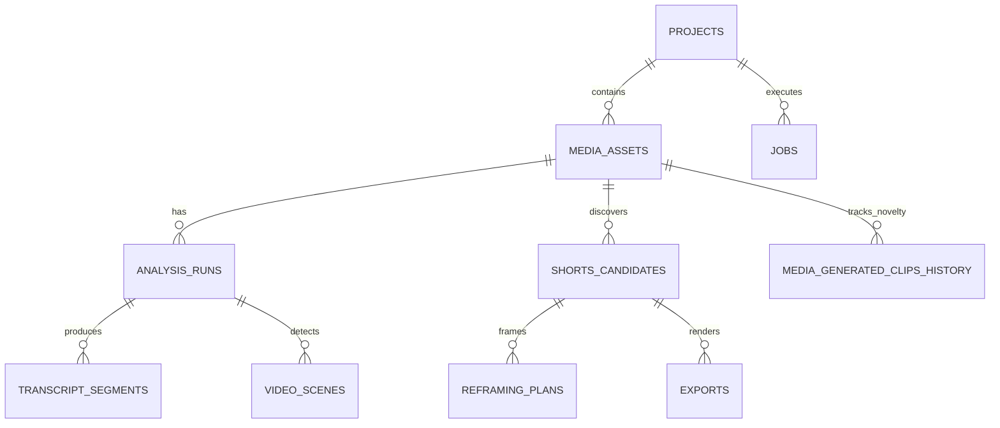

# ZezEdit 2.0 — Database & API Architecture Specification
**Date:** November 12, 2026  
**Document:** `docs/architecture/DATABASE_AND_API_DESIGN.md`  
**Status:** Target Architectural Design (Session 0)

---

## 1. Database Schema & Entity Relationships

The ZezEdit persistence layer is built on SQLite with WAL (Write-Ahead Logging) mode and foreign key constraints enabled.

### 1.1 Existing Core Entities (Retained & Reused)
- `projects`: Project container records (`id`, `name`, `storage_subdir`, `created_at`).
- `media_assets`: Primary media files (`id`, `project_id`, `original_filename`, `storage_path`, `duration_seconds`, `width`, `height`, `fps`, `proxy_status`).
- `analysis_runs`: Multi-stage video analysis records (`id`, `media_asset_id`, `status`, `progress_pct`, `current_stage`, `config_json`).
- `transcript_segments`: Word and segment-level Whisper transcript data (`id`, `analysis_run_id`, `start_time`, `end_time`, `text`, `words_json`).
- `video_scenes`: PySceneDetect cut points and thumbnail paths (`id`, `analysis_run_id`, `start_time`, `end_time`, `thumbnail_path`).
- `shorts_candidates`: Scored candidate moments (`id`, `project_id`, `media_asset_id`, `start_time`, `end_time`, `quality_score`, `category`, `score_breakdown_json`, `review_status`).
- `reframing_plans`: Crop trajectory definitions (`id`, `candidate_id`, `target_aspect_ratio`, `keyframes_json`, `status`).
- `exports`: Rendered MP4 records (`id`, `candidate_id`, `export_preset`, `target_aspect_ratio`, `output_path`, `status`, `validation_status`).
- `jobs`: Background job queue (`id`, `job_type`, `priority`, `status`, `progress_pct`, `current_stage`, `error_message`).

---

### 1.2 Proposed New Entity: `media_generated_clips_history`
To support the **Novelty & Non-Repetition Engine**, this table maintains a persistent temporal ledger of all generated clips across the lifecycle of a video:

```sql
CREATE TABLE IF NOT EXISTS media_generated_clips_history (
    id TEXT PRIMARY KEY,
    media_asset_id TEXT NOT NULL REFERENCES media_assets(id) ON DELETE CASCADE,
    project_id TEXT NOT NULL REFERENCES projects(id) ON DELETE CASCADE,
    generation_run_id TEXT NOT NULL,
    candidate_id TEXT REFERENCES shorts_candidates(id) ON DELETE SET NULL,
    start_time REAL NOT NULL,
    end_time REAL NOT NULL,
    duration REAL NOT NULL,
    aspect_ratio TEXT NOT NULL DEFAULT '9:16',
    creative_direction TEXT NOT NULL DEFAULT 'best_overall',
    quality_score REAL NOT NULL DEFAULT 0.0,
    title TEXT NOT NULL,
    exported INTEGER NOT NULL DEFAULT 0,
    created_at TEXT NOT NULL
);

-- Fast temporal overlap index
CREATE INDEX IF NOT EXISTS idx_clip_history_temporal 
ON media_generated_clips_history(media_asset_id, start_time, end_time);
```

### Entity Relationship Diagram


---

## 2. API Design & Endpoints

All endpoints follow RESTful conventions under `/api/v1` with standard JSON envelopes and HTTP status codes.

### 2.1 Unified Single-Video Studio Endpoints

#### 1. Get Video Studio Workspace Bundle
- **Endpoint:** `GET /api/v1/projects/{project_id}/media/{media_id}/studio`
- **Description:** Returns all data needed by `SingleVideoStudio.tsx` in a single request (media details, latest analysis state, discovered shorts, reframing previews, and generated clip history count).
- **Response Model:**
  ```json
  {
    "asset": { "id": "med_123", "filename": "movie.mp4", "duration": 3600.0, "width": 1920, "height": 1080 },
    "analysis_status": "completed",
    "active_job": null,
    "shorts_candidates": [
      {
        "id": "cand_01",
        "title": "The Confrontation",
        "start_time": 742.0,
        "end_time": 778.5,
        "duration": 36.5,
        "score": 92.4,
        "category": "Dramatic",
        "aspect_ratio": "9:16",
        "preview_url": "/api/v1/projects/p1/reframing/plans/ref_01/preview"
      }
    ],
    "history_summary": { "total_generated_clips": 10, "excluded_intervals_count": 10 }
  }
  ```

#### 2. Analyze & Generate Shorts (Unified Trigger)
- **Endpoint:** `POST /api/v1/projects/{project_id}/media/{media_id}/generate-shorts`
- **Description:** Upfront execution trigger. Checks if analysis is cached; if not, queues analysis job, followed automatically by novelty-aware candidate discovery and aspect-ratio crop calculation.
- **Request Model:**
  ```json
  {
    "aspect_ratio": "9:16",
    "target_clip_count": 10,
    "creative_direction": "dramatic",
    "min_duration": 15.0,
    "max_duration": 60.0,
    "include_subtitles": true,
    "force_reanalysis": false
  }
  ```
- **Response Model:**
  ```json
  {
    "job_id": "job_gen_9918",
    "status": "queued",
    "estimated_stages": ["audio_extract", "whisper_transcribe", "scene_detect", "discover_shorts", "calculate_framing"]
  }
  ```

#### 3. Real-Time Job Progress & Telemetry
- **Endpoint:** `GET /api/v1/jobs/{job_id}`
- **Description:** Returns live measurable percentage, current stage description, elapsed seconds, and calculated ETA.
- **Response Model:**
  ```json
  {
    "id": "job_gen_9918",
    "status": "running",
    "progress_pct": 68.5,
    "current_stage": "Calculating 9:16 face tracking & crop trajectories",
    "elapsed_seconds": 24.2,
    "estimated_seconds_remaining": 11.5,
    "error_message": null
  }
  ```

#### 4. Instant Single Clip Export
- **Endpoint:** `POST /api/v1/projects/{project_id}/candidates/{candidate_id}/export`
- **Description:** Enqueues background MP4 render for an individual approved short candidate with dynamic reframing and optional styled captions.

#### 5. Batch Export Queue
- **Endpoint:** `POST /api/v1/projects/{project_id}/exports/batch`
- **Description:** Enqueues render jobs for multiple selected candidates simultaneously.

---

### 2.2 Safe Maintenance & Cleanup Endpoints

#### 1. Calculate Recoverable Storage Preview
- **Endpoint:** `GET /api/v1/system/maintenance/storage-breakdown`
- **Description:** Non-destructive scan of managed storage roots calculating exact byte footprints across safe temporary files, proxies, caches, abandoned fragments, and user exports.
- **Response Model:**
  ```json
  {
    "managed_storage_bytes": 9019431321,
    "categories": {
      "temporary_processing_files": { "bytes": 3328599201, "safe_to_delete": true, "description": "Raw 16kHz WAVs and sampled visual frame JPEGs" },
      "regenerable_proxies": { "bytes": 1932735283, "safe_to_delete": true, "description": "480p proxy scrub videos" },
      "abandoned_job_fragments": { "bytes": 471859200, "safe_to_delete": true, "description": "Partial temp files from cancelled render jobs" },
      "completed_exports": { "bytes": 3004523120, "safe_to_delete": false, "description": "Rendered user MP4 exports" }
    },
    "total_safe_recoverable_bytes": 5733193684
  }
  ```

#### 2. Execute Bounded Safe Cleanup
- **Endpoint:** `POST /api/v1/system/maintenance/clean-safe-data`
- **Description:** Safely purges selected temporary files, caches, and abandoned fragments. Strictly skips original media assets and project records. Runs SQLite `VACUUM` and returns cleanup report.
- **Request Model:**
  ```json
  {
    "clean_temporary_processing": true,
    "clean_regenerable_proxies": true,
    "clean_abandoned_fragments": true,
    "clean_completed_exports": false
  }
  ```
- **Response Model:**
  ```json
  {
    "status": "success",
    "reclaimed_bytes": 5733193684,
    "deleted_files_count": 218,
    "database_vacuumed": true
  }
  ```

---

## 4. Candidate Discovery, Scoring & Novelty Endpoints (Session 4)

### 4.1 SQLite Schema Extensions (Migration 0013)
```sql
CREATE TABLE IF NOT EXISTS candidate_generation_runs (
    id TEXT PRIMARY KEY,
    project_id TEXT NOT NULL,
    media_asset_id TEXT NOT NULL,
    analysis_run_id TEXT NOT NULL,
    job_id TEXT,
    creative_direction TEXT NOT NULL DEFAULT 'best_overall',
    aspect_ratio TEXT NOT NULL DEFAULT '9:16',
    requested_count INTEGER NOT NULL DEFAULT 5,
    min_duration REAL NOT NULL DEFAULT 15.0,
    max_duration REAL NOT NULL DEFAULT 60.0,
    status TEXT NOT NULL DEFAULT 'completed',
    candidates_discovered INTEGER NOT NULL DEFAULT 0,
    candidates_selected INTEGER NOT NULL DEFAULT 0,
    candidates_rejected INTEGER NOT NULL DEFAULT 0,
    novelty_exclusions INTEGER NOT NULL DEFAULT 0,
    warnings_json TEXT DEFAULT '[]',
    error_message TEXT,
    created_at TEXT NOT NULL,
    completed_at TEXT,
    FOREIGN KEY (media_asset_id) REFERENCES media_assets(id) ON DELETE CASCADE
);

CREATE TABLE IF NOT EXISTS media_generated_clips_history (
    id TEXT PRIMARY KEY,
    media_asset_id TEXT NOT NULL,
    project_id TEXT NOT NULL,
    generation_run_id TEXT NOT NULL,
    candidate_id TEXT NOT NULL,
    start_time REAL NOT NULL,
    end_time REAL NOT NULL,
    duration REAL NOT NULL,
    creative_direction TEXT NOT NULL,
    aspect_ratio TEXT NOT NULL,
    score REAL NOT NULL,
    title TEXT,
    created_at TEXT NOT NULL,
    FOREIGN KEY (media_asset_id) REFERENCES media_assets(id) ON DELETE CASCADE
);

ALTER TABLE shorts_candidates ADD COLUMN generation_run_id TEXT;
ALTER TABLE shorts_candidates ADD COLUMN creative_direction TEXT DEFAULT 'best_overall';
ALTER TABLE shorts_candidates ADD COLUMN natural_boundary_confidence REAL DEFAULT 0.0;
```

### 4.2 Candidate Discovery Endpoints
- `POST /api/v1/projects/{project_id}/media/{media_asset_id}/highlights/discover`: Initial synchronous or asynchronous discovery.
- `POST /api/v1/projects/{project_id}/media/{media_asset_id}/highlights/generate-more`: Non-repetition extraction querying `media_generated_clips_history` to exclude overlapping moments ($\text{tIoU} \ge 0.50$).
- `GET /api/v1/projects/{project_id}/media/{media_asset_id}/highlights/runs`: Lists candidate generation batches with counts, exclusions, and creative directions.
- `GET /api/v1/projects/{project_id}/media/{media_asset_id}/highlights/history`: Retrieves cumulative interval history and coverage statistics.
