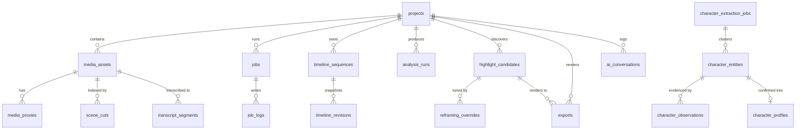

# ZezEdit 2.0 — Database Design & Migration Strategy

## 1. Engine & Pragmas

ZezEdit 2.0 uses **SQLite 3** as its single structured metadata store (`storage/db/zezedit.db`). Large binary data (video, audio, proxies, thumbnails, rendered outputs) MUST NEVER be stored as SQLite BLOBs.

Every SQLite connection configures:
```sql
PRAGMA journal_mode = WAL;
PRAGMA synchronous = NORMAL;
PRAGMA foreign_keys = ON;
PRAGMA busy_timeout = 5000;
```

**Why SQLite WAL?** Enables concurrent reads by FastAPI endpoints (e.g., polling `/jobs` or timeline state) while the background orchestrator writes progress updates without blocking readers, with zero Windows database-server daemon installation required.

---

## 2. Versioned Migration Strategy (Historical Lesson Applied)

In the earlier ZezEdit codebase (`db_backup.pyc` historical inspection), schema management evolved into >55 tables defined inline inside a monolithic Python module with ad-hoc `ALTER TABLE` blocks, accumulating dead 3D Character Studio tables that caused maintenance hazards.

ZezEdit 2.0 enforces **forward-only numbered SQL migrations**:
- Directory: `backend/migrations/`
- Naming pattern: `NNNN_short_description.sql` (e.g., `0001_initial_schema.sql`, `0002_media_analysis.sql`).
- Tracking table (`schema_migrations`):
  - `version TEXT PRIMARY KEY` (e.g., `"0001"`)
  - `name TEXT NOT NULL`
  - `checksum_sha256 TEXT NOT NULL`
  - `applied_at TEXT NOT NULL`
- **Rules:**
  1. Never edit an already-applied migration file. Checksum mismatches raise a startup failure alert rather than silently corrupting state.
  2. Migrations execute inside explicit SQLite transactions (`BEGIN ... COMMIT`, rolling back on error).
  3. Before applying new pending migrations when upgrading an existing database, the migrator automatically snapshots `zezedit.db` to `storage/backups/pre_migration_NNNN.db`.

---

## 3. Planned Domain Entity Relationship Diagram



---

## 4. Schema Breakdown: Implemented vs Planned

### Implemented Tables (Migrations 0001–0005)

1. **`0001_initial_schema.sql`**:
   - `schema_migrations`: Migration version ledger (`version`, `name`, `checksum_sha256`, `applied_at`).
   - `app_settings`: Key-value JSON settings store (`key`, `value_json`, `updated_at`).
   - `projects`: Base project table (`id`, `name`, `description`, `status`, `storage_subdir`, `created_at`, `updated_at`, `archived_at`).
   - `jobs`: Authoritative background job ledger.

2. **`0002_core_management.sql`**:
   - `media_assets`: Primary asset records, paths, dimensions, duration, relinking states.
   - `project_events`: Audit log for project operations.

3. **`0003_media_pipeline.sql`**:
   - Upgrades `media_assets` with `proxy_status` and indexing.

4. **`0004_video_analysis.sql`**:
   - `analysis_runs`: Run status, profiles (`fast`, `balanced`, `detailed`), progress, stage.
   - `transcript_segments`: Faster-Whisper segments with word timestamps and confidence.
   - `speech_turns`: Dialogue turns grouped across conversational pauses with statement/question classification.
   - `video_scenes`: Visual scene cuts, midpoint representative timestamps, change scores.
   - `sampled_frames`: Downscaled keyframe registry for vision models.
   - `visual_observations`: Structured visual scene understanding from Ollama or heuristic fallback.

5. **`0005_highlight_candidates.sql`**:
   - `shorts_candidates`: Shorts clip records with boundaries (`start_time`, `end_time`, `suggested_start_time`, `suggested_end_time`, `is_user_modified`), scores (`quality_score`, `score_breakdown_json`), gates (`gate_results_json`, `warnings_json`, `missing_evidence_json`, `review_status`, `rejection_reason`), citations (`transcript_references_json`, `scene_references_json`, `visual_evidence_json`, `audio_evidence_json`, `ai_explanation_json`), overlap tracking (`overlap_group_id`, `alternative_of_candidate_id`), `scoring_version="2.0.0-m6"`, and `queued_for_render`.

6. **`0006_smart_reframing.sql`**:
   - `reframing_plans`: Primary reframing plan for a media asset (`id`, `project_id`, `media_asset_id`, `target_aspect_ratio`, `framing_strategy`, `base_zoom`, `headroom_factor`, `smoothing_window`, `tracking_data_json`, `keyframes_json`, `active_revision_id`, `created_at`, `updated_at`).
   - `reframing_revisions`: Immutable versioned ledger of reframing iterations (`id`, `plan_id`, `project_id`, `revision_number`, `note`, `keyframes_json`, `manual_overrides_json`, `rendered_output_path`, `render_status`, `created_at`).

7. **`0007_export_pipeline.sql`**:
   - `exports`: Rendered export metadata and status tracking (`id`, `project_id`, `candidate_id`, `media_asset_id`, `reframing_plan_id`, `framing_revision_id`, `render_job_id`, `title`, `export_preset`, `target_aspect_ratio`, `target_width`, `target_height`, `video_codec`, `audio_codec`, `pixel_fmt`, `fps`, `crf`, `video_bitrate`, `audio_bitrate`, `caption_config_json`, `audio_config_json`, `output_path`, `output_filename`, `file_size_bytes`, `duration_seconds`, `status`, `validation_status`, `validation_details_json`, `error_message`, `created_at`, `completed_at`).

---

### Planned Tables for Subsequent Milestones (Schema Blueprint)

- **Milestone 2 (`0002_media_library.sql`):**
  - `media_assets`: `id`, `project_id`, `role` (`primary` | `broll` | `audio` | `image`), `original_filename`, `storage_path`, `external_source_path`, `sha256`, `file_size_bytes`, `duration_seconds`, `metadata_json`, `availability_status` (`present` | `missing` | `deleted`), `created_at`.
  - `media_proxies`: `id`, `media_asset_id`, `proxy_type` (`480p_edit` | `waveform` | `thumb_strip`), `file_path`, `width`, `height`, `status`, `created_at`.
- **Milestone 3 (`0003_job_logs_and_recovery.sql`):**
  - `job_logs`: `id`, `job_id`, `level`, `message`, `created_at`.
- **Milestone 5 (`0004_analysis_and_highlights.sql`):**
  - `analysis_runs`, `scene_cuts`, `transcript_segments`, `visual_frame_observations`, `highlight_candidates` (`start_time`, `end_time`, `setup_score`, `payoff_score`, `ranking_score`, `rationale_json`, `status`).
- **Milestone 6 (`0005_reframing_and_revisions.sql`):**
  - `tracking_trajectories`, `manual_crop_overrides` (`id`, `project_id`, `candidate_id`, `export_id`, `rel_timestamp`, `center_x`, `center_y`, `zoom`, `scene_segment_idx`), `export_revisions`.
- **Milestone 7 (`0006_timeline_editor.sql`):**
  - `timeline_sequences` (`id`, `project_id`, `title`, `fps`, `width`, `height`, `active_document_json`, `version`), `timeline_revisions` (undo/redo & autosave snapshots).
- **Milestone 8 (`0007_export_pipeline.sql`):**
  - `exports` (`id`, `project_id`, `candidate_id`, `media_asset_id`, `reframing_plan_id`, `render_job_id`, `title`, `export_preset`, `target_aspect_ratio`, `target_width`, `target_height`, `video_codec`, `audio_codec`, `duration_seconds`, `status`, `validation_status`, `validation_details_json`).
- **Milestone 9 (`0008_timeline_editor.sql`):**
  - `timelines`: (`id`, `project_id`, `name`, `duration`, `fps`, `canvas_width`, `canvas_height`, `time_base`, `revision`, `is_active`).
  - `timeline_tracks`: (`id`, `timeline_id`, `name`, `track_type`, `track_subtype`, `track_order`, `is_visible`, `is_muted`, `is_locked`, `height`).
  - `timeline_clips`: (`id`, `timeline_id`, `track_id`, `source_media_id`, `clip_type`, `name`, `timeline_start`, `timeline_end`, `source_in`, `source_out`, `speed`, `volume`, `opacity`, `transform_props`, `content_props`, `audio_props`).
  - `timeline_commands`: (`id`, `timeline_id`, `command_type`, `payload`, `inverse_payload`, `revision_before`, `revision_after`, `description`, `executed_by`, `is_undone`). Persistent undo/redo history surviving restarts.
  - `ai_conversations`: (`id`, `project_id`, `timeline_id`, `title`).
  - `ai_editing_plans`: (`id`, `conversation_id`, `project_id`, `timeline_id`, `target_revision`, `user_instruction`, `explanation`, `operations`, `warnings`, `status`).
  - `ai_messages`: (`id`, `conversation_id`, `role`, `content`, `context_snapshot`, `plan_id`).
- **Milestone 11 (`0009_character_extraction.sql`):**
  - Character entity models and observation tracking.

---

## 5. Limitations & Alternatives Considered

- **Alternative Considered:** ORM-driven auto-migrations (SQLAlchemy + Alembic).
- **Decision:** Direct `sqlite3` with explicit SQL files (`0001_*.sql`).
- **Why:** Keeps Windows packaging lightweight with zero SQLAlchemy session-locking pitfalls during async FastAPI + multi-threaded FFmpeg workers, while maintaining exact SQL visibility and auditability.
- **Limitation:** Queries require manual parameterized SQL maintenance in repository modules rather than ORM attribute sugar.
