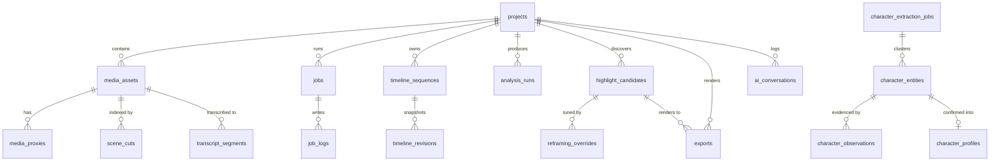

# ZezEdit 2.0 — Database Design & Migration Strategy

## 1. Engine & Pragmas

ZezEdit 2.0 uses **SQLite 3** as its single structured metadata store (`storage/db/zezedit.db`). Large binary data (video, audio, proxies, thumbnails, rendered outputs) MUST NEVER be stored as SQLite BLOBs.

Every SQLite connection configures:
```sql
PRAGMA journal_mode = WAL;
PRAGMA synchronous = NORMAL;
PRAGMA foreign_keys = ON;
PRAGMA busy_timeout = 5000;
```

**Why SQLite WAL?** Enables concurrent reads by FastAPI endpoints (e.g., polling `/jobs` or timeline state) while the background orchestrator writes progress updates without blocking readers, with zero Windows database-server daemon installation required.

---

## 2. Versioned Migration Strategy (Historical Lesson Applied)

In the earlier ZezEdit codebase (`db_backup.pyc` historical inspection), schema management evolved into >55 tables defined inline inside a monolithic Python module with ad-hoc `ALTER TABLE` blocks, accumulating dead 3D Character Studio tables that caused maintenance hazards.

ZezEdit 2.0 enforces **forward-only numbered SQL migrations**:
- Directory: `backend/migrations/`
- Naming pattern: `NNNN_short_description.sql` (e.g., `0001_initial_schema.sql`, `0002_media_analysis.sql`).
- Tracking table (`schema_migrations`):
  - `version TEXT PRIMARY KEY` (e.g., `"0001"`)
  - `name TEXT NOT NULL`
  - `checksum_sha256 TEXT NOT NULL`
  - `applied_at TEXT NOT NULL`
- **Rules:**
  1. Never edit an already-applied migration file. Checksum mismatches raise a startup failure alert rather than silently corrupting state.
  2. Migrations execute inside explicit SQLite transactions (`BEGIN ... COMMIT`, rolling back on error).
  3. Before applying new pending migrations when upgrading an existing database, the migrator automatically snapshots `zezedit.db` to `storage/backups/pre_migration_NNNN.db`.

---

## 3. Planned Domain Entity Relationship Diagram



---

## 4. Schema Breakdown: Implemented vs Planned

### Implemented in Milestone 1 (`0001_initial_schema.sql`)

To support the Milestone 1 foundation safely without premature bloat:

1. **`schema_migrations`**: Migration version ledger (`version`, `name`, `checksum_sha256`, `applied_at`).
2. **`app_settings`**: Key-value JSON settings store (`key`, `value_json`, `updated_at`) for user preferences, AI provider config, and UI state.
3. **`projects`**: Minimal baseline project header (`id`, `name`, `description`, `status`, `storage_subdir`, `created_at`, `updated_at`, `archived_at`).
4. **`jobs`**: Authoritative job ledger skeleton (`id`, `project_id`, `job_type`, `status`, `priority`, `progress_pct`, `current_stage`, `worker_pid`, `payload_json`, `result_json`, `error_message`, `attempt_count`, `max_attempts`, `created_at`, `started_at`, `completed_at`, `updated_at`).

---

### Planned Tables for Subsequent Milestones (Schema Blueprint)

- **Milestone 2 (`0002_media_library.sql`):**
  - `media_assets`: `id`, `project_id`, `role` (`primary` | `broll` | `audio` | `image`), `original_filename`, `storage_path`, `external_source_path`, `sha256`, `file_size_bytes`, `duration_seconds`, `metadata_json`, `availability_status` (`present` | `missing` | `deleted`), `created_at`.
  - `media_proxies`: `id`, `media_asset_id`, `proxy_type` (`480p_edit` | `waveform` | `thumb_strip`), `file_path`, `width`, `height`, `status`, `created_at`.
- **Milestone 3 (`0003_job_logs_and_recovery.sql`):**
  - `job_logs`: `id`, `job_id`, `level`, `message`, `created_at`.
- **Milestone 5 (`0004_analysis_and_highlights.sql`):**
  - `analysis_runs`, `scene_cuts`, `transcript_segments`, `visual_frame_observations`, `highlight_candidates` (`start_time`, `end_time`, `setup_score`, `payoff_score`, `ranking_score`, `rationale_json`, `status`).
- **Milestone 6 (`0005_reframing_and_revisions.sql`):**
  - `tracking_trajectories`, `manual_crop_overrides` (`id`, `project_id`, `candidate_id`, `export_id`, `rel_timestamp`, `center_x`, `center_y`, `zoom`, `scene_segment_idx`), `export_revisions`.
- **Milestone 7 (`0006_timeline_editor.sql`):**
  - `timeline_sequences` (`id`, `project_id`, `title`, `fps`, `width`, `height`, `active_document_json`, `version`), `timeline_revisions` (undo/redo & autosave snapshots).
- **Milestone 8 (`0007_ai_editor.sql`):**
  - `ai_conversations`, `ai_messages`, `ai_edit_plans` (`plan_json`, `validation_status`, `execution_status`, `applied_timeline_revision_id`).
- **Milestone 9 (`0008_character_extraction.sql`):**
  - `character_extraction_jobs`, `character_entities`, `character_observations`, `confirmed_character_profiles` (explicitly preserving non-3D evidence-based design from historical M13M.10–11).
- **Milestone 10 (`0009_exports_and_backups.sql`):**
  - `exports` (`id`, `project_id`, `timeline_id`, `candidate_id`, `aspect_ratio`, `preset`, `output_path`, `revision`, `ffprobe_verified`, `file_size_bytes`, `created_at`), `backups`.

---

## 5. Limitations & Alternatives Considered

- **Alternative Considered:** ORM-driven auto-migrations (SQLAlchemy + Alembic).
- **Decision:** Direct `sqlite3` with explicit SQL files (`0001_*.sql`).
- **Why:** Keeps Windows packaging lightweight with zero SQLAlchemy session-locking pitfalls during async FastAPI + multi-threaded FFmpeg workers, while maintaining exact SQL visibility and auditability.
- **Limitation:** Queries require manual parameterized SQL maintenance in repository modules rather than ORM attribute sugar.
