# ZezEdit 2.0 — Multi-Session Implementation Roadmap
**Date:** November 12, 2026  
**Document:** `docs/architecture/IMPLEMENTATION_ROADMAP.md`  
**Status:** Target Architectural Roadmap (Session 0)

---

## 1. Roadmap Overview & Session Sequence

The transformation of ZezEdit 2.0 into an intuitive, unified, video-centric shorts generation studio is organized into **8 discrete, dependency-ordered sessions** (Session 0 through Session 7).

```mermaid
flowchart LR
    S0["Session 0: Audit & Architecture Design"] --> S1["Session 1: Navigation & Media Library Unslopping"]
    S1 --> S2["Session 2: Single-Video Studio UI & Upfront Controls"]
    S2 --> S3["Session 3: Unified Full-Video Analysis Pipeline"]
    S3 --> S4["Session 4: Candidate Discovery, Scoring, Natural Cuts & Novelty"]
    S4 --> S5["Session 5: Framed Player Preview, Interactive Showcase & Editing"]
    S5 --> S6["Session 6: Actual FFmpeg Rendering, Subtitles & Batch Export"]
    S6 --> S7["Session 7: Safe Maintenance Cleanup, Full Regression & Release"]
```

---

## 2. Detailed Session Specifications

### Session 0: Audit, Architecture Redesign & Implementation Roadmap
- **Status:** **Completed in this turn (Analysis & Design Only).**
- **Objective:** Exhaustive codebase audit, Graphify traversal, `/unslop` audit, and complete system design. Zero code modifications.
- **Deliverables:**
  - `docs/architecture/SESSION_0_AUDIT_REPORT.md`
  - `docs/architecture/UNIFIED_VIDEO_STUDIO_DESIGN.md`
  - `docs/architecture/VIDEO_INTELLIGENCE_PIPELINE.md`
  - `docs/architecture/DATABASE_AND_API_DESIGN.md`
  - `docs/architecture/IMPLEMENTATION_ROADMAP.md`

---

### Session 1: Navigation Simplification & Media Library Unslopping
- **Status:** **Completed.**
- **Objective:** Eliminate visual slop, remove disconnected sidebar tools, and streamline Media Library cards to a single clear action.
- **Dependencies:** Session 0 approval.
- **Files Affected:**
  - `frontend/src/app/App.tsx` (Sidebar navigation cleanup).
  - `frontend/src/features/media/MediaLibraryView.tsx` (Card CTAs, emoji removal).
  - `frontend/src/features/reframing/ReframingWorkspace.tsx` (Emoji removal).
  - `frontend/src/features/settings/SettingsManager.tsx` (Emoji removal).
- **Frontend Work:**
  - Remove *Video Analysis*, *AI Highlights*, *Smart Reframing*, and *Shorts Export* from primary sidebar.
  - Retain: `Dashboard`, `Projects`, `Media Library`, `Timeline Editor`, `Working Queue`, `AI Providers`, `Settings`.
  - Replace cluttered card buttons with one primary button: **"Open Video Studio"** (with `Sliders` line icon).
  - Eradicate all emojis (`✨`, `🎯`, `🎬`, `📁`, `🤖`, `👥`, `👤`, `🛡`, `🎙`, `⚡`, `🔒`).
- **Tests & Verification:**
  - `npm test -- --run` passes 88/88 tests.
  - `npx tsc --noEmit` code 0.
  - `npm run build` succeeds cleanly.
  - Browser screenshot evidence captured.
- **Definition of Done:** Sidebar is simplified, media cards feature single primary CTA, zero emojis remain in UI text, and all automated tests pass.

---

### Session 2: Dedicated Single-Video Studio UI & Upfront Controls
- **Status:** **Completed.**
- **Objective:** Build the unified `SingleVideoStudio.tsx` page with top progress bar and upfront configuration controls.
- **Dependencies:** Session 1.
- **Files Affected:**
  - `frontend/src/features/studio/SingleVideoStudio.tsx` (New component).
  - `frontend/src/app/App.tsx` (Route wiring for `/studio/:assetId`).
  - `frontend/src/features/media/MediaLibraryView.tsx` (Connect "Open Video Studio" to load studio).
  - `frontend/src/test/singleVideoStudio.test.tsx` (New test suite).
- **Frontend Work:**
  - Create `SingleVideoStudio.tsx` with header (back button, filename, duration, resolution, size).
  - Build top Global Progress Bar showing percentage, current stage, and elapsed/remaining time.
  - Build Upfront Configuration Bar:
    - Aspect Ratio pills: `9:16 Vertical`, `1:1 Square`, `16:9 Landscape`, `4:5 Portrait`.
    - Quantity selector: `5`, `6`, `10`, `15`, `20`, custom number.
    - Creative direction dropdown: `Best Overall`, `Dramatic`, `Action & Motion`, `Emotional / Sad`, `Engaging Dialogue`.
    - Action CTA: **"Analyze & Generate Shorts"**.
- **Backend Work:**
  - Provide initial composite workspace endpoint `/api/v1/projects/{pid}/media/{mid}/studio`.
- **Definition of Done:** Clicking any video opens the studio page, displays metadata, renders the upfront controls, and reflects active configuration state.

---

### Session 3: Unified Full-Video Analysis Pipeline
- **Status:** **Completed.**
- **Objective:** Unify audio extraction, Faster-Whisper transcription, PySceneDetect cut detection, keyframe sampling, and visual understanding into a single background pipeline capable of processing 1–2 GB movies without OOM errors.
- **Dependencies:** Session 2.
- **Files Affected:**
  - `backend/app/db/migrations/0012_unified_analysis_pipeline.sql` (Migration adding `job_id`, `source_signature`, `stage_details_json`, `checkpoint_data_json`).
  - `backend/app/models/entities.py` (Entity updates for `AnalysisRunRecord`).
  - `backend/app/services/analysis_pipeline.py` (Full pipeline rewrite with bounded streaming, source signature, JobOrchestrator sync, telemetry, and cancellation).
  - `backend/app/services/transcription.py` (Faster-Whisper int8 CPU transcriber with automatic VAD retry fallback for singing/dialogue over music).
  - `backend/app/services/jobs.py` (State synchronization and completion clamping fix).
  - `backend/app/services/visual_understanding.py` (Fast heuristic fallback when Ollama vision model is slow/offline).
  - `backend/app/api/v1/analysis.py` (Endpoints for telemetry, cancel, retry, and cache info).
  - `frontend/src/features/studio/SingleVideoStudio.tsx` (Real-time telemetry banner, stage progress %, elapsed time, cancel/retry buttons, and cache info badge).
  - `frontend/src/services/apiClient.ts` (API methods for telemetry, cancel, retry, cache info).
  - `backend/tests/test_session3_unified_analysis.py` (Dedicated 7-test suite for Session 3).
- **Backend Work:**
  - Implemented sequential staged execution across full video duration: Ingest validation $\rightarrow$ 16kHz mono audio demux $\rightarrow$ Faster-Whisper word-level transcription with VAD fallback $\rightarrow$ Dialogue turn segmentation $\rightarrow$ Scene boundary detection $\rightarrow$ Visual frame sampling $\rightarrow$ Semantic observation extraction $\rightarrow$ SQLite persistence.
  - Source signature computation (`size:mtime:hash64k`) in $< 1\text{ms}$ without loading full video files.
  - Stage-aware caching: reuses completed run when source signature is unchanged; automatically invalidates cache when media file changes.
  - Bounded memory streaming via FFmpeg out-of-process pipes for 1–2 GB files.
  - Real-time stage telemetry, elapsed duration, and job synchronization via `JobOrchestrator`.
- **Tests & Verification:**
  - Dedicated test suite `tests/test_session3_unified_analysis.py`: 7 tests passed (100%).
  - Analysis regression suites `test_milestone5_analysis.py` and `test_milestone15_analysis_parity.py`: 13 tests passed (100%).
  - Frontend Vitest suite: 94 tests passed (100%).
  - TypeScript compiler (`tsc --noEmit`): 0 errors.
  - Vite production build (`vite build`): completed in 5.66s.
- **Definition of Done:** Pipeline successfully analyzes a full video end-to-end, persists transcript and scene records, and reports live progress to client.

---

### Session 4: Candidate Discovery, Scoring, Natural Cuts & Novelty Engine
- **Status:** **Completed.**
- **Objective:** Implement multimodal moment scoring, natural dialogue boundary snapping, and persistent non-repetition filtering across consecutive runs.
- **Dependencies:** Session 3.
- **Files Affected:**
  - `backend/migrations/0013_candidate_discovery_novelty.sql` (Tables `candidate_generation_runs`, `media_generated_clips_history`, and candidate boundary confidence columns).
  - `backend/app/models/entities.py` (`CandidateGenerationRunRecord`, `MediaGeneratedClipHistoryRecord`, extended `ShortsCandidateRecord`).
  - `backend/app/services/highlight_discovery.py` (Full multimodal discovery engine, 7 creative directions, natural boundary snapping, persistent novelty ledger with tIoU filtering, distinct moment selection, and JobOrchestrator sync).
  - `backend/app/api/v1/highlights.py` (`POST .../generate-more`, `GET .../runs`, `GET .../runs/{id}`, `GET .../history`).
  - `frontend/src/types/highlights.ts` (Typed interfaces for generation runs, novelty history, multimodal breakdown).
  - `frontend/src/services/apiClient.ts` (API methods for `generateMoreHighlights`, `fetchCandidateGenerationRuns`, `fetchCandidateNoveltyHistory`).
  - `frontend/src/features/studio/SingleVideoStudio.tsx` (Candidate cards with Attractiveness estimate, Natural Cut confidence badge, creative direction pill, expandable 6-signal breakdown grid, novelty banner, and Candidate Batches drawer).
  - `backend/tests/test_session4_candidate_discovery.py` (5 comprehensive backend tests, 100% pass).
  - `frontend/src/test/session4_candidate_discovery.test.tsx` (4 comprehensive frontend tests, 100% pass).
- **Backend Work:**
  - Applied SQLite migration 0013 adding `candidate_generation_runs` and `media_generated_clips_history`.
  - Natural boundary expansion: word-aligned sentence closure on terminal punctuation (`.`, `!`, `?`), 0.15s lead-in margin, and scene boundary snapping ($\le 0.45$s) to eliminate flash frames.
  - Persistent novelty engine: calculates temporal Intersection-over-Union ($\text{tIoU} \ge 0.50$) and candidate overlap ratio ($\ge 0.60$) against all historical intervals in `media_generated_clips_history`.
  - 7 creative directions: `best_overall`, `viral_punchy`, `dramatic`, `action_motion`, `emotional_sad`, `engaging_dialogue`, `humorous`.
  - Distinct candidate moment selection preventing duplicate scene cuts within the same batch.
- **Tests & Verification:**
  - Dedicated backend suite `tests/test_session4_candidate_discovery.py`: 5/5 passed.
  - Highlight discovery regression suite `tests/test_milestone6_highlights.py`: 3/3 passed.
  - Dedicated frontend suite `src/test/session4_candidate_discovery.test.tsx`: 4/4 passed.
  - Studio regression suite `src/test/singleVideoStudio.test.tsx`: 6/6 passed.
  - Real-media verification on `Ek Mota Hathi Ghumne Chala.mp4`: Batch 1 discovered 4 punchy shorts; Batch 2 discovered 4 dramatic shorts; max tIoU between batches was **0.373** (strictly $< 0.50$).
- **Definition of Done:** Candidate moments are discovered, scored with explainable breakdowns, snapped cleanly without cutting words, and filtered for persistent novelty on repeat runs.

---

### Session 5: Interactive Clip Preview, Editing, Smart Reframing & Subject Tracking [COMPLETED]
- **Objective:** Wire the live preview player with dynamic reframing, provide interactive candidate clip preview & trimming, and support smart subject tracking and manual positioning.
- **Dependencies:** Session 4.
- **Status:** **COMPLETE & VERIFIED** (2026-11-12)
- **Implemented Architecture:**
  - `backend/migrations/0014_candidate_clip_edits.sql`: Database migration creating `candidate_clip_edits` table with isolated edit persistence preserving immutable candidate discovery data and novelty records.
  - `backend/app/services/clip_editing_service.py`: High-level candidate clip editing service for bounds validation, aspect ratio framing, manual positioning offsets, and reset-to-original.
  - `backend/app/api/v1/clip_edits.py`: REST API endpoints for GET/PUT edit state, POST reset, and POST smart tracking.
  - `backend/app/services/reframing_service.py`: Extended to support interval-bounded tracking with explicit `start_time` and `end_time` parameters and 4:5 aspect ratio dimensions.
  - `frontend/src/features/studio/CandidateClipEditorModal.tsx`: Interactive clip preview modal with bounded playback loop, dynamic aspect ratio crop box overlay, timeline trimming handles with +/-0.5s adjusters, aspect ratio buttons (9:16, 1:1, 16:9, 4:5), and framing mode tabs.
  - `frontend/src/features/studio/SingleVideoStudio.tsx`: "Edit Clip" button on candidate cards opening focused clip editor modal.
  - `backend/tests/test_session5_clip_editing.py` & `frontend/src/test/session5_clip_editing.test.tsx`: Comprehensive automated unit and integration tests (100% pass).
- **Definition of Done:** Candidate clips can be interactively previewed, trimmed, framed, tracked, and persisted without modifying original discovery data.

---

### Session 6: Actual FFmpeg Rendering, Subtitles & Batch Export
- **Objective:** Render real, standalone, playable MP4 video files with dynamic crop trajectories and burned-in subtitles.
- **Dependencies:** Session 5.
- **Files Affected:**
  - `backend/app/services/export_service.py`
  - `backend/app/services/caption_engine.py`
  - `backend/app/api/v1/exports.py`
  - `frontend/src/features/exports/BatchExportModal.tsx`
  - `backend/tests/test_actual_rendering.py`
- **Backend & Frontend Work:**
  - Connect single-click "Export MP4" on candidate card to dispatch background render job.
  - Connect "Export All" header button to trigger batch export for all approved candidates.
  - Burn in styled ASS subtitles when enabled.
  - Validate output file with FFprobe (non-zero bytes, valid streams, exact duration match).
- **Definition of Done:** Real playable MP4 video files are produced on disk in the target aspect ratio, playable in VLC/browser, and downloadable.

---

### Session 7: Safe Maintenance Cleanup, Full Regression & Release
- **Objective:** Implement safe one-button temporary file cleanup, perform full regression test suite, execute `/unslop` redline audit, and verify production release readiness.
- **Dependencies:** Session 6.
- **Files Affected:**
  - `backend/app/services/cleanup_service.py` (New safe cleanup service).
  - `backend/app/api/v1/system.py` or `settings.py` (Maintenance endpoints).
  - `frontend/src/features/settings/SettingsManager.tsx` (Maintenance tab).
  - All test suites (`pytest`, `vitest`, `tsc`, `vite build`).
- **Work:**
  - Build Maintenance & Storage Cleanup tab: displays recoverable bytes for temporary files, proxies, and caches.
  - Build single-button "Clean Safe Temporary Data" action (strictly preserves original media and project edits).
  - Run full test suite: $\ge 121$ Pytest tests, $\ge 88$ Vitest tests, TypeScript compile, Vite production build.
  - Run browser end-to-end verification walkthrough.
- **Definition of Done:** Safe cleanup reclaims space without data loss, all automated tests pass with 100% rate, and application is fully verified.
