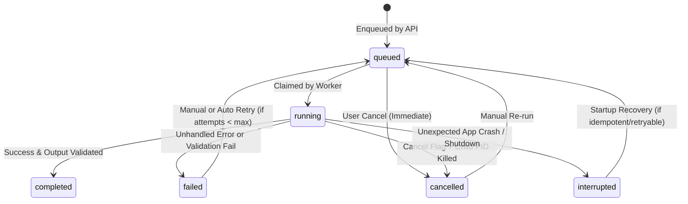

# ZezEdit 2.0 — Authoritative Job Orchestration Design

## 1. Core Mandate: One Single Job System

ZezEdit 2.0 prohibits multiple independent background task queues or unmonitored `threading.Thread` fire-and-forget calls. Every long-running workload (proxy creation, transcription, video analysis, highlight discovery, reframing tracking, MP4 rendering, model downloads, character extraction, backups) executes through **`JobOrchestrator`** in `backend/app/workers/`.

---

## 2. Job States & Lifecycle Transitions

**UI Reporting Rule (`BUG-08A-5` Historical Fix):**
- `running_count` strictly counts jobs with `status == "running"`.
- `queued_count` strictly counts jobs with `status == "queued"`.
- Top navigation counters NEVER merge queued jobs into "Running".

---

## 3. Canonical Job Types & Concurrency Policy

On the target Intel i3-1220P CPU / 20 GB RAM machine, concurrent heavy CPU workloads cause thermal throttling and Ollama OOM timeouts. Jobs classify into resource lanes:

| Job Type | Resource Class | Default Concurrency Limit | Notes |
|---|---|---|---|
| `proxy_generation`, `ffmpeg_render`, `export` | `heavy_cpu` | `1` (Global) | Bounded FFmpeg threads (`-threads 4`) |
| `whisper_transcribe`, `video_analysis`, `character_extract` | `heavy_ai` | `1` (Shared heavy lane) | Never runs concurrently with heavy renders |
| `ollama_model_pull` | `network_io` | `1` | Async streaming; tracks downloaded bytes |
| `thumbnail_strip`, `metadata_probe` | `light_io` | `2` | Fast bounded tasks |

---

## 4. Worker Ownership & Child Process PID Registry

Every active worker loop maintains an in-memory and DB-persisted ownership claim:
- `worker_pid`: OS process ID of spawned child subprocess (`ffmpeg`, `ffprobe`, etc.).
- When `POST /api/v1/jobs/{job_id}/cancel` is called:
  1. If `queued`: atomically transitions SQLite row to `cancelled`.
  2. If `running`: sets `cancel_requested` event and sends termination (`TerminateProcess` / `proc.terminate()`, fallback `taskkill /F /T /PID` on Windows after 2s grace) to the registered child PID.
  3. Cleans ONLY `storage/temp/jobs/{job_id}/` owned by that job; NEVER touches `storage/media/` or other jobs' files.

---

## 5. Restart Recovery Rules

During FastAPI startup (`SYSTEM_ARCHITECTURE.md`):
1. Query `SELECT * FROM jobs WHERE status = 'running'`.
2. Any record left `running` belonged to a terminated process.
3. For cleanly checkpointed or idempotent job types (`proxy_generation`, `video_analysis`): mark `interrupted` or automatically requeue if `attempt_count < max_attempts` and user preference enables auto-resume.
4. For mid-stream renders (`ffmpeg_render`, `export`): mark `interrupted` with message `"Backend stopped while rendering; temporary partial output discarded. Click Retry to re-render."` and purge only `storage/temp/jobs/{job_id}/`.

---

## 6. Retry Rules & Per-Job Logs

- Each job carries `attempt_count` and `max_attempts` (default `2` for transient I/O/Ollama timeouts; `1` for invalid input failures).
- Every stage milestone (`0% Probing`, `25% Transcribing`, `80% Rendering`, `100% Verified`) writes to:
  1. SQLite `jobs` row (`progress_pct`, `current_stage`, `updated_at`).
  2. Structured per-job log table/file (`job_logs` + `storage/logs/jobs/{job_id}.log`) so users can inspect exact FFmpeg stderr or Whisper tracebacks in Diagnostics without opening a console window.

---

## 7. Alternatives Considered & Limitations

- **Alternative Considered:** Celery + Redis or RQ.
- **Decision:** In-process Python `asyncio` + `ThreadPoolExecutor` / `subprocess` orchestrator backed by SQLite WAL.
- **Why:** Running a separate Redis server and Celery daemon on end-user Windows 11 desktops adds setup fragility, firewall prompts, and multi-process orphaned PID headaches.
- **Limitation:** Horizontal multi-machine scaling is not supported (irrelevant for single-desktop local-first ZezEdit).
