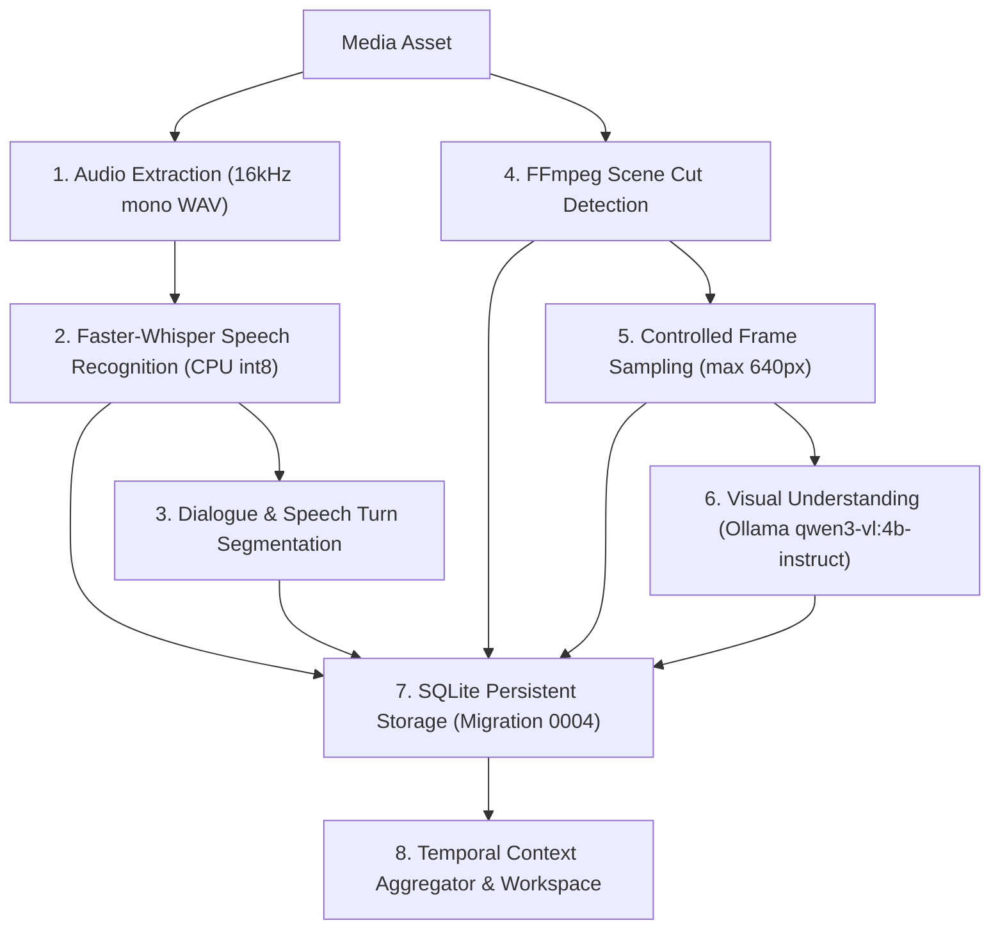
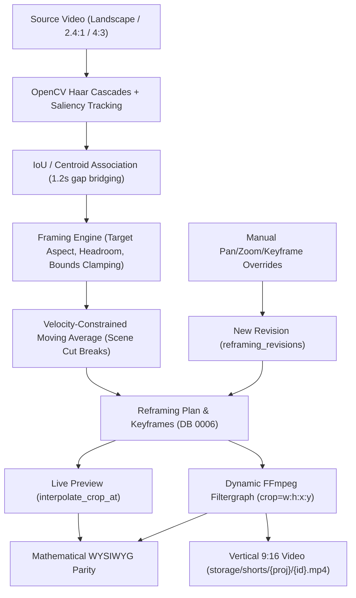
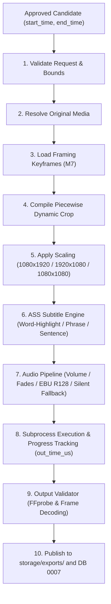

# ZezEdit 2.0 — Media Storage & Processing Pipeline

## 1. Storage Separation & Source Immutability

All binary media lives strictly inside configured `ZEZEDIT_STORAGE_ROOT`, separated by lifecycle and ownership:

| Subdirectory | Purpose | Mutable? | Deletion / Cleanup Policy |
|---|---|---|---|
| `media/` | Original imported video & audio assets | **NO (Immutable)** | Explicit user-confirmed deletion only; never altered or overwritten |
| `proxies/` | Low-bitrate H.264 480p proxies for smooth timeline scrubbing | Derived | Regenerable; cleaned only on project deletion or explicit user storage purge |
| `thumbnails/` | JPEG cover frames & timeline scrub strips | Derived | Regenerable per asset/short |
| `analysis/` | Cached scene JSON, Whisper transcripts, tracking telemetry JSON | Derived | Checkpoint artifacts per project |
| `timelines/` | Exported timeline sequence JSON backups | Project Data | Preserved with project |
| `shorts/` | Rendered Shorts & non-destructive revisions (`{id}.mp4`, `{id}_rev2.mp4`) | User Outputs | Never overwritten; explicit confirmation to delete |
| `exports/` | Final 16:9 / 9:16 / 1:1 timeline exports | User Outputs | Never overwritten silently |
| `temp/` | Ephemeral FFmpeg/Whisper scratch (`temp/jobs/{job_id}/`) | Scratch | Strictly owned by `job_id`; purged when job completes/fails/cancels |
| `backups/` | SQLite pre-migration & user-triggered zip/db snapshots | Archive | Strictly distinct from working state |
| `logs/` | Rotating app logs + per-job logs | Diagnostics | Size-capped rolling logs |
| `db/` | SQLite WAL files (`zezedit.db`, `-wal`, `-shm`) | System State | Snapshotted before migrations |

---

## 2. Large-File (1–2 GB+) Streaming Pipeline (CPU-First)

To handle 1–2 GB+ video files safely within 20 GB RAM without OOM or UI freezes:
1. **No Full-Video RAM Buffering:** Never decode an entire video into `numpy` arrays in memory.
2. **Metadata Probe First:** `ffprobe -v quiet -print_format json -show_format -show_streams` inspects dimensions, codecs, SAR/DAR, rotation tags, audio layout, and duration in milliseconds.
3. **Chunked / Sampled Frame Extraction:**
   - **Scene Detection & Tracking:** OpenCV reads sampled frames or FFmpeg extracts downscaled (`640x360`) sparse frames via pipe/sequential iteration rather than caching thousands of 1080p frames in RAM.
   - **Audio Extraction:** Single-channel `16kHz PCM WAV` extracted to `temp/jobs/{job_id}/audio.wav` via `ffmpeg -vn -ac 1 -ar 16000` for CPU Faster-Whisper (`int8` compute type recommended on i3-1220P).
4. **Edit Proxies:** Long 1080p/4K clips generate a lightweight `480p` fast-keyframe MP4 proxy (`-g 15 -preset veryfast -threads 4`) so HTML5 `<video>` timeline scrubbing in the browser stays responsive while final exports still render directly from the original immutable `media/` source.

---

## 3. Smart Reframing & Portrait Rendering Architecture

Preserving verified architectural solutions from historical Milestone 13M.12–13 (`milestone_13m12_verification_report.md`):

### Framing Strategy Selection
- **Dynamic Subject Tracking (`smart_crop`):** Primary portrait mode filling full 1080x1920 height without black bars or small horizontal strips.
- **Two-Person Dialogue Joint Framing:** Evaluates joint bounding midpoint (`group_cx, group_cy`) keeping both speakers inside the 9:16 window rather than jumping erratically or falling back prematurely to blur padding.
- **Blur-Fill Fallback Threshold:** Reserved strictly for user selection or extreme multi-subject wide spreads (>65% frames exceeding span thresholds); when active, scales foreground cleanly (`scale=1080:-2`) over blurred backdrop.

### Authoritative Crop Math & Preview Parity
- One deterministic function (`evaluate_crop_at_timestamp`) computes `(crop_x, crop_y, crop_w, crop_h)` from:
  1. Validated user **Manual Override Keyframes** (highest precedence, scene-segment isolated)
  2. Smoothed **Automatic Tracking Trajectory** (EMA smoothed + velocity-clamped, snapped cleanly at scene cuts without dragging pan across cuts)
  3. **Safe Center Fallback**
- Both the **Frame Preview API** (rendering JPEG crop box overlays) and the **FFmpeg Filtergraph Compiler** consume this exact function, ensuring 100% WYSIWYG mathematical parity.
- **Non-Destructive Revisions:** Saving manual overrides renders `{short_id}_rev{N}.mp4` + `{short_id}_rev{N}_diagnostics.json` alongside revision 1 so users can compare or roll back anytime.

---

## 5. Milestone 4 Implementation Details: Media Ingestion & Proxies

### Supported Media Formats
- **Video:** MP4, MOV, MKV, WebM, AVI, M4V, MPEG/MPG, TS, FLV, WMV
- **Audio:** MP3, WAV, AAC, M4A, FLAC, OGG, Opus, WMA
- **Images:** JPEG, PNG, WEBP, GIF, BMP, TIFF

### Ingestion Workflows
1. **Local External Reference (`is_external = True`):**
   - Validates file existence and permissions.
   - Preserves source file at user's existing filesystem location without duplication.
   - Extracts complete FFprobe technical metadata and generates a cached preview thumbnail.
2. **Managed Storage Copy (`is_external = False`):**
   - Verifies available disk space (ensuring $>100\text{ MB}$ headroom).
   - Streams source into `storage/media/{project_subdir}/{uuid}_{filename}` in $1\text{ MB}$ chunks via `shutil.copyfileobj`.
   - Never loads the complete file into RAM, enabling safe handling of $1-2\text{ GB}+$ assets on Intel i3 hardware.
3. **Chunked HTTP Upload:**
   - Endpoint: `POST /api/v1/projects/{project_id}/media/upload`.
   - Streams multipart chunks directly to disk without intermediate in-memory buffering.

### Deterministic Thumbnail & Proxy Paths
- **Thumbnails:** `storage/thumbnails/{asset_id}.jpg` (JPEG Lanczos-scaled to $\min(640, \text{iw})$)
- **Proxies:** `storage/proxies/{asset_id}_proxy_{profile}.mp4`
  - Profiles: `360p` ($\min(640, \text{iw}):-2$), `480p` ($\min(854, \text{iw}):-2$), `720p` ($\min(1280, \text{iw}):-2$)
  - Encoding: `libx264`, `veryfast`, `crf 26`, `aac` $128\text{k}$, `-threads 4`, `+faststart` for zero-lag HTML5 scrubbing.

### Safety & Deletion Guarantees
- Deleting an asset removes its project record and purges derivative proxies/thumbnails.
- Original source files for **external** assets are never deleted or modified.
- Managed copies are only deleted from disk if the user explicitly confirms `delete_source=True`.

Every export job runs two mandatory stages:
1. **Deterministic FFmpeg Execution:**
   - Subprocess invoked via explicit `argv` list (never `shell=True`), bounded with `-threads 4`, `-movflags +faststart`, `-pix_fmt yuv420p`, `libx264`, and `aac`.
   - Writes to `storage/temp/jobs/{job_id}/output.mp4` first, then atomically moves/renames to target `exports/` or `shorts/` path only after validation passes.
   - Refuses to overwrite an existing output path unless explicit overwrite/new-revision confirmation is supplied.
2. **Post-Render FFprobe Verification Gate:**
   - Verifies file exists and `size > 0`.
   - Verifies decoded duration is within tolerance of requested timeline/clip duration.
   - Verifies exact target resolution (`1080x1920`, `1920x1080`, `1080x1080`) and expected audio presence.

---

## 5. Video Analysis Engine (Milestone 5)

Implemented in Milestone 5 as a modular, 8-stage pipeline combining CPU-first media processing and local AI:

### Components
1. **Audio Extraction (`audio_extractor.py`):** Uses FFmpeg to extract clean 16kHz mono 16-bit PCM WAV to ephemeral job scratch, isolating audio processing from video containers.
2. **Speech Recognition (`transcription.py`):** Faster-Whisper CPU provider (`WhisperModel`, `int8` quantization, VAD filter). Computes segment boundaries and word-level timestamps. Includes PyAV 14+ compatibility patch.
3. **Dialogue Segmentation (`speech_segmentation.py`):** Groups segments across conversational pauses (`> 0.8s`), marks turns as statement/question/exclamation, and detects speaker changes.
4. **Scene Boundary Detection (`scene_detector.py`):** FFmpeg scene cut filter (`select='gt(scene,0.35)'`) yielding timestamp boundaries and representative midpoints.
5. **Controlled Frame Sampling (`frame_sampler.py`):** Scene-aware keyframe extraction downscaled to 640px, capped per profile (fast: 20, balanced: 50, detailed: 100).
6. **Visual Understanding (`visual_understanding.py`):** Queries local Ollama (`qwen3-vl:4b-instruct`) for factual observations (setting, subjects, text, activity) with graceful deterministic heuristic fallback when Ollama is offline or uninstalled.
7. **Temporal Aggregator (`temporal_aggregator.py`):** Unifies scenes, speech turns, transcript segments, and visual observations into high-speed temporal window queries (`get_temporal_context_at`).
8. **Analysis Workspace (`AnalysisWorkspace.tsx`):** Split-view UI with synchronized player, interactive scrub bar, searchable transcript, scene cuts strip, and live context inspector.

---

## 6. Smart Reframing & Dynamic Crop Renderer (Milestone 7)

### Components
1. **Subject Tracker (`subject_tracker.py`):** Multi-cascade face and upper-body detector with OpenCV saliency fallback. Associates detections across sampled intervals, bridges momentary occlusions up to 1.2s, and halts tracks at scene cuts.
2. **Framing Engine (`framing_engine.py`):** Computes aspect crops (`9:16`, `1:1`, `16:9`) respecting target aspect ratio, even integer constraints, and strict video boundary clamping. Implements single-subject, two-person conversation framing, and fallback strategies.
3. **Trajectory Smoothing:** Windowed moving average with `max_pan_velocity` limits. Splits trajectory by scene cuts so camera position steps instantly across shots without blurry pans.
4. **Authoritative Crop Parity:** `FramingEngine.interpolate_crop_at(t)` and `build_crop_filter_expression(keyframes)` use identical piecewise-linear mathematics.
5. **FFmpeg Piecewise-Linear Renderer (`reframing_renderer.py`):** Compiles keyframes into time-varying FFmpeg crop expressions (`crop=w:h:x:y`), applies `scale=1080:1920`, encodes with `libx264` (`yuv420p`), synchronizes audio, and executes post-render FFprobe verification.
6. **Non-Destructive Revisions & UI:** User edits generate versioned revisions in `reframing_revisions`. Dual viewports (Source with dynamic overlay + 9:16 Canvas) in `ReframingWorkspace.tsx` allow real-time adjustment and one-click render.

---

## 7. Rendering Engine & Export Pipeline (Milestone 8)

### Components
1. **Export Presets (`export.py`):** Standard profiles for YouTube Shorts/Reels (`1080x1920`), Widescreen (`1920x1080`), and Square (`1080x1080`).
2. **Caption Engine (`caption_engine.py`):** Generates `.ass` subtitles with word-by-word highlight colors (`{\c&H...&}`), phrase bursts, sentences, custom fonts, outline/shadow, and safe bottom margins.
3. **Audio Pipeline (`audio_pipeline.py`):** Implements linear volume scaling, audio fade-in/out, EBU R128 loudness normalization, 48kHz stereo resampling, and synthesizes silent stereo audio if source is video-only.
4. **15-Stage Modular Coordinator (`export_service.py`):** Manages end-to-end rendering in temporary scratch spaces, streaming progress to `JobOrchestrator`, tracking PIDs, and handling cancellation.
5. **Output Validator Gate (`output_validator.py`):** Validates file existence, non-zero size, container readability, resolution, duration tolerances, and tests frame decodability via FFmpeg null sink.
6. **Shorts Export Studio (`ExportStudio.tsx`):** Split-view frontend with configuration tabs, live progress monitoring, HTML5 video player, and export history.
