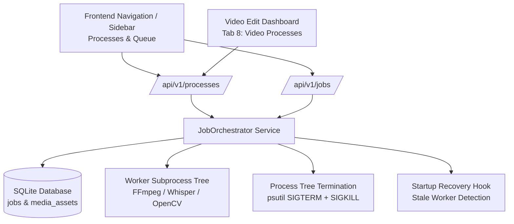

# Central Process Manager Architecture & Operational Design

## 1. Overview & Core Philosophy

ZezEdit 2.0 is a local-first, CPU-optimized video intelligence and short-form creation suite. In previous versions, background operations (video transcoding, Whisper speech-to-text, frame sampling, scene detection, clip reframing, and rendering) ran as disparate jobs across isolated views, providing limited centralized observability and inconsistent lifecycle controls.

The **Central Process Manager** consolidates all execution telemetry into a unified, reliable control plane. It satisfies three primary product mandates:
1. **Global Process Visibility**: Unifies tracking of all background tasks across all videos and system operations on a single dedicated page (`/processes` and `/queue`).
2. **Deterministic Lifecycle Controls**: Enables users to cancel/terminate active subprocess trees, retry interrupted or failed operations with full history lineage, and delete terminal process records.
3. **Backend Recovery & Parity**: Automatically detects stale workers on backend restarts, transitions orphaned tasks to `interrupted` with checkpoint preservation, and maintains full dual-route API parity (`/api/v1/processes` and `/api/v1/jobs`).

---

## 2. Process Manager System Architecture



---

## 3. Database Schema & Lineage Tracking

Database Migration `0016_process_manager_and_storage_reclamation.sql` upgraded the persistent `jobs` table with explicit relational indices:

```sql
ALTER TABLE jobs ADD COLUMN media_asset_id TEXT;
ALTER TABLE jobs ADD COLUMN parent_job_id TEXT;

CREATE INDEX IF NOT EXISTS idx_jobs_media_asset ON jobs (media_asset_id);
CREATE INDEX IF NOT EXISTS idx_jobs_parent_job ON jobs (parent_job_id);
```

### Key Fields & Attributes:
- **`media_asset_id`**: Links a process directly to its parent source video. Allows instant video-specific filtering (`GET /api/v1/processes?media_asset_id={id}`).
- **`parent_job_id`**: Links retried jobs into an immutable provenance chain. When a failed job is retried with `create_new_attempt=True`, the original attempt remains preserved as `failed`, while the new job references it via `parent_job_id` with an incremented `retry_count`.
- **`video_title`**: Automatically resolved on the backend via SQL `LEFT JOIN media_assets m ON j.media_asset_id = m.id` using `m.original_filename`.
- **`elapsed_seconds` & `estimated_remaining_seconds`**: Real-time duration metrics computed dynamically based on start time, progress percentage, and stage completion.

---

## 4. Process Classification & Categorization

Processes in ZezEdit fall into 5 distinct functional categories:

| Category | Job Types | CPU / Resource Priority | Description |
| :--- | :--- | :--- | :--- |
| **Media** | `video_upload`, `video_validation`, `generate_proxy`, `regenerate_thumbnail`, `media_relink` | Normal (100) | Ingestion, format probing, lightweight proxy generation, and thumbnail creation. |
| **Analysis** | `analyze_video`, `audio_extraction`, `whisper_transcription`, `scene_detection`, `frame_sampling` | High (150) | Full multimodal video intelligence, speech transcription, visual keyframe analysis. |
| **Generation** | `highlight_discovery`, `generate_more_shorts`, `script_synthesis` | High (150) | Narrative scoring, boundary selection, and non-repeating clip proposal generation. |
| **Rendering** | `render_clip`, `export_mp4`, `burn_subtitles`, `smart_reframing` | Critical (200) | FFmpeg video encoding, subtitle burn-in, crop panning, and MP4 generation. |
| **Storage** | `cache_cleanup`, `clear_all_user_data`, `database_backup`, `backup_restore` | Normal (100) | Transient file purging, database compaction, and complete storage reclamation. |

---

## 5. Subprocess Lifecycle Management & Termination

On Windows and Unix platforms, terminating a Python parent worker often leaves orphaned `ffmpeg.exe` or `whisper` child processes holding open file handles.

The Process Manager implements a robust recursive process tree termination mechanism using `psutil`:

```python
def _terminate_pid_tree(self, pid: int, timeout: float = 3.0) -> None:
    """Recursively terminate a process and all its child workers."""
    try:
        parent = psutil.Process(pid)
        children = parent.children(recursive=True)
        for child in children:
            try:
                child.terminate()
            except psutil.NoSuchProcess:
                pass
        parent.terminate()
        _, alive = psutil.wait_procs(children + [parent], timeout=timeout)
        for p in alive:
            try:
                p.kill()
            except psutil.NoSuchProcess:
                pass
    except psutil.NoSuchProcess:
        pass
```

### Graceful File Release:
After child processes terminate, `gc.collect()` and brief retry loops are executed to release Windows file locks (`[WinError 32]`) before unlinking temporary cache or aborting files.

---

## 6. Restart Recovery & Crash Resilience

If the application terminates unexpectedly (system reboot, user crash, or manual server kill), workers left in `running` or `cancelling` status cannot continue unsupervised.

On server boot, `JobOrchestrator.recover_interrupted_jobs()` runs automatically:
1. Queries all jobs where `status IN ('running', 'cancelling')`.
2. Inspects `checkpoint_data_json` to determine whether intermediate stages and artifacts exist.
3. Updates the job status to `interrupted` and sets `current_stage = 'server_restart_interrupted'`.
4. Emits detailed timeline logs recording the interruption reason, allowing users to inspect or click "Retry Attempt".

---

## 7. Dual Route Parity

To ensure that both legacy endpoints and the new Process Manager frontend interact seamlessly without breaking external integrations:
- `/api/v1/processes` (New primary route)
- `/api/v1/jobs` (Standard route)

Both routers share identical parameters, return formats, query filtering, and cancellation/deletion handlers.
