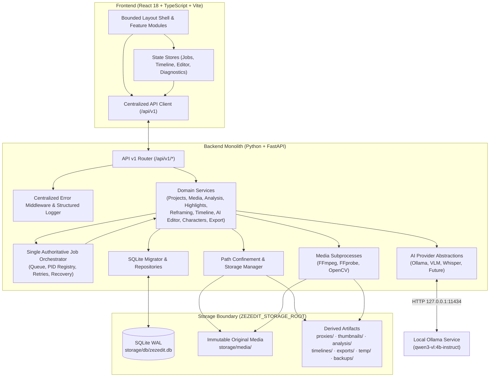

# ZezEdit 2.0 — System Architecture

## 1. Overview & Guiding Principles

ZezEdit 2.0 is a modular monolith running locally on Windows 11. Instead of splitting into fragile microservices, a single FastAPI backend process coordinates SQLite persistence, FFmpeg/OpenCV subprocess execution, a single authoritative job orchestrator, and pluggable local AI providers (`Ollama`, `Faster-Whisper`). A React + TypeScript + Vite + Tailwind frontend communicates exclusively with `/api/v1/*` HTTP/SSE endpoints.

Core design principles:
1. **Local-First & CPU-First:** Everything runs without cloud credentials or NVIDIA CUDA GPUs on Intel Core i3-1220P / 20 GB RAM hardware.
2. **Strict Layer Separation:** HTTP routes validate payloads and delegate to service modules; services do not embed raw FFmpeg shell orchestration or SQL strings scattered across endpoints.
3. **AI Planning vs Deterministic Execution:** LLMs/VLMs generate structured JSON plans validated by Pydantic schemas before any deterministic editing or rendering service executes.
4. **Historical Lessons Applied:** Avoids the 55-table monolithic `db.py`, ad-hoc UI scroll traps (`BUG-08A-1/2/3`), competing job runners, and 3D Character Studio bloat found in historical ZezEdit logs.

---

## 2. High-Level System Architecture

---

## 3. Frontend Module Boundaries (`frontend/src/`)

| Directory | Responsibility | Rules & Boundaries |
|---|---|---|
| `app/` | Root shell (`App.tsx`), routing, stationary navigation sidebar (`BUG-08A-1/2` prevention) | Enforces `h-screen max-h-screen overflow-hidden` root viewport |
| `components/` | Reusable dumb/presentational UI components (modals, video players, tooltips, badges) | Must not execute direct `fetch()` calls; receive props/callbacks |
| `features/` | Self-contained domain views (`dashboard`, `projects`, `media`, `analysis`, `reframing`, `timeline`, `ai-editor`, `characters`, `exports`, `settings`) | Each feature owns its UI sub-components and feature hooks |
| `hooks/` | Shared React hooks (debounced sliders, polling, keyboard shortcuts) | Reusable stateful logic independent of visual markup |
| `services/` | Centralized typed API client (`apiClient.ts`) & error normalizer | Single place managing `/api/v1` base URL, timeouts, AbortController, and typed errors |
| `stores/` | Lightweight state stores (React Context or Zustand when justified, e.g., active Jobs, Timeline document) | Separates `running` vs `queued` counts (`BUG-08A-5`) |
| `types/` | Shared TypeScript interfaces mirroring `shared/contracts/` | Synchronized with backend Pydantic schemas |
| `styles/` | Tailwind CSS theme tokens & bounded NLE utility classes | Zero inline global body scroll hacks |

---

## 4. Backend Module Boundaries (`backend/app/`)

| Package | Responsibility | Rules & Boundaries |
|---|---|---|
| `api/` | Versioned FastAPI routers (`/api/v1`), dependency injection, HTTP status translation | Zero business logic, zero direct SQL or FFmpeg CLI strings |
| `core/` | App settings (`config.py`), `storage.py`, `security.py`, `logging.py`, `errors.py`, `binaries.py` | Enforces path confinement and startup environment validation |
| `db/` | SQLite WAL connection factory, forward-only `migrator.py`, base repository helpers | No business rules; parameterized SQL queries only |
| `models/` | Internal domain dataclasses / DB row projections | Distinct from external Pydantic request/response DTOs |
| `schemas/` | Pydantic v2 DTOs (requests, responses, error envelopes, AI structured outputs) | Defines API & AI validation contracts |
| `services/` | Domain logic for Projects, Media, Analysis, Highlights, Reframing, Timeline, AI Planning/Execution, Characters, Exports | Reusable across HTTP routes and background jobs |
| `workers/` | Single authoritative `JobOrchestrator` & subprocess PID registry | Owns worker thread/async loop, concurrency cap, cancellation, and recovery |
| `integrations/` | Pluggable adapters for `Ollama`, `VisionLanguageProvider`, `SpeechToTextProvider`, and FFmpeg/OpenCV wrappers | Degrades cleanly if a binary or daemon is offline |

---

## 5. AI Provider Abstraction Boundaries

ZezEdit defines protocol interfaces in `backend/app/integrations/`:
- `TextLLMProvider`: `health_check()`, `list_models()`, `generate_structured(prompt, json_schema)`
- `VisionLanguageProvider`: `health_check()`, `describe_frames(frame_paths, prompt, schema)`
- `SpeechToTextProvider`: `health_check()`, `transcribe_audio(wav_path, language=None)`

Key safety & honesty guarantees:
- **Graceful Degradation:** Missing Ollama daemon, unloaded models, or unconfigured Whisper never crash startup (`GET /api/v1/health` reports capability availability clearly).
- **Schema Validation Gate:** Every AI output (highlight suggestions, natural-language `EditPlan`) is parsed against strict Pydantic schemas before reaching any executor.
- **No Unverified Claims:** Providers never execute arbitrary OS commands, write arbitrary filesystem paths, or emit unverified "viral probabilities" / biometric identity guarantees.

---

## 6. Windows 11 Startup & Shutdown Lifecycle

### Startup Sequence
1. Load configuration from environment / `.env` (`backend/app/core/config.py`).
2. Initialize structured rotating file + console logging under `storage/logs/`.
3. Validate `ZEZEDIT_STORAGE_ROOT` is NOT a filesystem root (e.g., `D:\`), not inside critical OS folders, and initialize required subdirectories (`db`, `media`, `proxies`, `thumbnails`, `analysis`, `timelines`, `exports`, `shorts`, `temp`, `backups`, `logs`).
4. Initialize SQLite connection (`PRAGMA journal_mode=WAL`, `PRAGMA foreign_keys=ON`, `PRAGMA busy_timeout=5000`) and run pending forward-only SQL migrations (`migrations/*.sql`).
5. **Startup Recovery (Scheduled Milestone 3):** Scan `jobs` table for orphaned `running` records from an unclean exit and transition them to `interrupted` or `queued` per retry policy; quarantine stale unowned temp directories without deleting media.
6. Probe FFmpeg, FFprobe, and Ollama (`GET /api/tags`) non-blockingly with generous timeouts (8s).

### Graceful Shutdown Sequence
1. Reject new incoming job dispatches cleanly (`503 Service Shutting Down`).
2. Signal cancellation to active worker tasks and wait up to grace timeout (e.g., 5s) before terminating tracked FFmpeg/Whisper child PIDs cleanly (`taskkill` / `.terminate()` on Windows).
3. Persist final job states (`interrupted`) and flush SQLite WAL checkpoint (`PRAGMA wal_checkpoint(TRUNCATE)`).
4. Close HTTP client connection pools (`httpx.AsyncClient`) and file log handlers.
