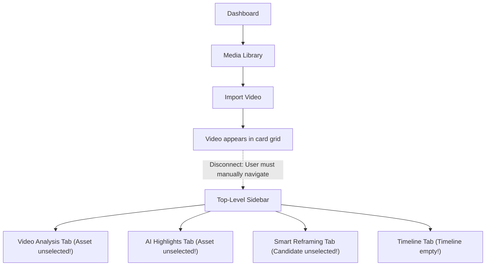
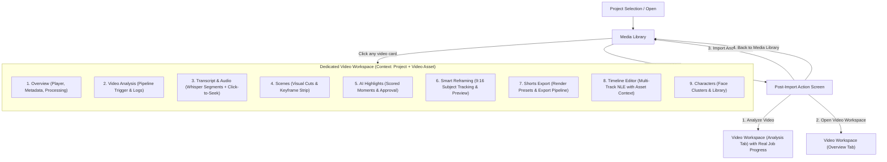

# ZezEdit 2.0 — UI, Navigation & Feature Gap Analysis
**Milestone 11 Audit & Restoration Document**  
**Audit Framework:** Unslop (Damir Sokolovsky) & Graphify AST Knowledge Graph  
**Target:** `D:\ZezEdit`  
**Date:** November 2026

---

## 1. Executive Summary

A comprehensive design and architectural audit of ZezEdit 2.0 was conducted using **Unslop** (`/unslop`) and **Graphify** (`graphify query`, `explain`, `path`). 

While Milestones 1 through 10 successfully implemented powerful backend processing engines (media ingestion, FFmpeg probing/proxy creation, faster-whisper transcription, OpenCV/YOLO/YuNet computer vision, multi-signal highlight scoring, 9:16 subject reframing, FFmpeg rendering, and multi-track timelines), the user interface suffered from a severe structural disconnect:
- It was presented as a **SaaS analytics dashboard with disconnected utility tools** rather than a **desktop-first video editing application**.
- Navigation forced users to leave their media, navigate to top-level sidebar routes, and manually select assets over and over.
- Milestone developer badges (`M5`, `M6`, `M7`, `M8`, `M9`, `M10`) cluttered the primary navigation.
- The Media Library did not cleanly hand off imported assets to an intelligent analysis and editing workflow.

---

## 2. Unslop Visual & Interaction Audit

### A. Surfaces and Colors
| Component / File | Current Issue | Unslop Redline Correction |
|---|---|---|
| `DashboardView.tsx` Hero | Multi-stop gradient `from-indigo-950/40 via-surface to-surface` with purple sparkles badge | Solid studio surface (`#16191e`) with quiet hairline border (`#262a33`); remove decorative gradient |
| `App.tsx` Sidebar | Brand icon container has glow border `border-indigo-500/30` and background `bg-indigo-600/15` | Clean slate mark with neutral hairline; no glow |
| `App.tsx` Navigation | Every navigation item has a different color (`text-sky-400`, `text-amber-400`, `text-indigo-400`, `text-emerald-400`) | Unified monochrome icons taking the text role (`text-text-secondary`); only the active item receives a subtle surface step |
| Badges | Developer milestone badges (`M5`, `M6`, etc.) on navigation items | Remove developer labels; show user-facing tools or item counts |
| Cards & Borders | Thick borders and mismatched radiuses across views | 4px scale, uniform radius (`rounded-xl` for cards, `rounded-lg` for controls), hairline borders (`border-border`) |

### B. Typography & Copy
| Component | Current Text | Unslop Correction |
|---|---|---|
| Dashboard Hero Title | `Local-First AI Video Editor` + `v2.0.0-alpha.1` Sparkle pill | `Video Studio` or Project Title; clean status keycap |
| Dashboard Tagline | *"CPU-first video processing, context-aware vertical reframing, and multi-track timeline editing right on your workstation."* | Concise contextual guidance or direct project workspace entry |
| Navigation Section Labels | `STUDIO TOOLS`, `SYSTEM` (uppercase tracked) | `Workspace`, `System` (sentence case, quiet mono) |
| Empty States | Vague text like *"No media items found"* | Actionable empty state with clear dropzone and import trigger |

---

## 3. Product Workflow Gap Analysis

### Current Broken Workflow:

### Required Video-Centric Workflow (Milestone 11):

---

## 4. Feature Recovery Matrix

| Capability | Milestone Built | Current Functional State | Integration Status in M11 |
|---|---|---|---|
| Project Creation & Switch | M1-M3 | Fully operational via API | Centralized project switcher in global header |
| Media Ingestion & Metadata | M4 | Fully operational (FFprobe, thumbnails, proxies) | Enhanced with real thumbnails, storage badges, PostImportModal |
| Post-Import Action Screen | M11 | Previously missing | Implemented via `PostImportModal.tsx` |
| Video Analysis Pipeline | M5 | Fully operational (Whisper, scenes, frames) | Integrated as Tab 2 in `VideoWorkspace.tsx` |
| Transcript & Audio | M5 | Fully operational with word timestamps | Integrated as Tab 3 in `VideoWorkspace.tsx` with search & seek |
| Scene Cut Inspector | M5 | Fully operational | Integrated as Tab 4 in `VideoWorkspace.tsx` |
| AI Highlight Discovery | M6 | Fully operational (scoring & ranking) | Integrated as Tab 5 in `VideoWorkspace.tsx` scoped to active video |
| Smart Reframing Studio | M7 | Fully operational (9:16 subject tracking) | Integrated as Tab 6 in `VideoWorkspace.tsx` scoped to active video |
| Shorts Export Pipeline | M8 | Fully operational (real FFmpeg video render) | Integrated as Tab 7 in `VideoWorkspace.tsx` scoped to active video |
| Multi-Track Timeline | M9 | Fully operational (tracks, cuts, transitions) | Integrated as Tab 8 in `VideoWorkspace.tsx` with preloaded assets |
| AI Timeline Editor | M9 | Fully operational (natural language plans) | Integrated in Timeline sub-workspace |
| Character Studio | M10 | Fully operational (YuNet / Haar face clusters) | Integrated as Tab 9 in `VideoWorkspace.tsx` scoped to active video |

---

## 5. Unslop Design Direction for ZezEdit 2.0

- **Product:** A desktop-first local AI video editor for creators transforming long videos into vertical shorts and multi-track timelines.
- **Character:** `precise, studio-dark, quiet`.
- **World:** High-end non-linear editing studio (DaVinci / Avid aesthetic): deep slate neutrals, 1px hairlines, tabular timecode keycaps, no decorative gradients.
- **Moments:** The Video Workspace Preview Canvas and the Multi-Track Timeline Strip.
- **Signature:** Timecode Keycap (`00:01:24.08`) and live bounding box framing overlay.
