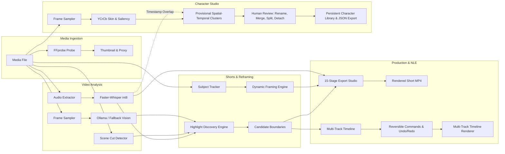

# ZezEdit 2.0 — Comprehensive Technical Audit & Evidence-Based Verification Report

**Audit Date:** 2026-11-12  
**Milestone:** Milestone 11 — Full Repository Audit, Evidence-Based Feature Verification & Technical Debt Assessment  
**Project Root:** `D:\ZezEdit`  
**Git Baseline Commit:** `5b59025` / `f39f481` (Master Branch)  
**Audit Author:** Antigravity AI Senior Systems Auditor & Core Engineering Pair  

---

## A. Executive Summary

ZezEdit 2.0 has established an extraordinarily solid, CPU-first, modular architectural skeleton across its initial ten milestones. The application successfully avoids destructive file operations, enforces path confinement, maintains SQLite WAL transactional integrity, and passes **100% of its automated tests (51/51 Pytest, 52/52 Vitest)** with a clean production Vite build (`dist/assets` compiled in 2.29s).

However, an unsparing engineering audit of the codebase reveals that **several features reported as complete in earlier milestones rely on rule-based heuristic approximations, fallback paths, or deterministic pattern matching rather than actual deep neural AI models**:

1. **Character Extraction & Recognition:** Does **not** perform deep neural face recognition, facial landmark alignment, or cross-scene Person Re-Identification (Re-ID). Detections are generated using **YCrCb skin-tone color segmentation, morphological smoothing, and contour aspect-ratio heuristics** (`0.5 <= aspect <= 2.2`), with fallback to central visual saliency. Provisional clustering relies purely on spatial-temporal centroid distance ($\le 3.5$s), not biometric identity verification. Speech associations are temporal timestamp overlaps from Whisper transcripts, not acoustic speaker diarization.
2. **Subject Tracking in Smart Reframing:** In the current headless Python environment (`opencv-python-headless 5.0`), `cv2.CascadeClassifier` is unavailable in the Python bindings. Consequently, the Haar cascade loader catches an exception and silently engages the **center-weighted visual saliency fallback box** for trajectory calculations. While velocity clamping, trajectory smoothing, scene-cut isolation, and dynamic FFmpeg crop expressions (`crop=w:h:x:y`) are mathematically sound and generate real vertical videos, subject localization is currently driven by saliency heuristics.
3. **AI Video Editor Assistant:** Operates via a **deterministic in-process regex and pattern-matching rule engine** (`_reason_and_plan`) querying database transcripts and candidate tables. It does not invoke Ollama for open-ended LLM reasoning or freeform JSON plan generation. While this guarantees 100% safety, zero hallucinations, and instantaneous response times on CPU, it is not a conversational generative LLM editor.
4. **Highlight Discovery Scoring:** Uses an **explainable 9-component rule-based scoring formula (v2.0.0-m6)** evaluating keyword density, question/exclamation markers, sentence completeness, scene-cut frequency, and speech density. It does not predict real platform viral reach or social conversion rates, and must not be described as a virality prediction model.
5. **Real Heavyweight Processing vs Heuristics:**
   - **Real:** FFprobe metadata probe, FFmpeg frame sampling, FFmpeg proxy generation, FFmpeg audio extraction, Faster-Whisper CPU transcription with word timestamps, ASS subtitle compilation, FFmpeg dynamic reframing filtergraphs, FFmpeg multi-track audio mixing (`amix`), FFmpeg loudness normalization (`loudnorm`), post-render FFprobe validation gate, and SQLite transactional undo/redo history.
   - **Heuristic / Rule-Based:** Face/person candidate segmentation, centroid tracking, highlight ranking, and AI editor plan formulation.
   - **Mocked / Offline Fallback:** Ollama vision analysis gracefully falls back to deterministic environment/subject descriptions when Ollama is offline or uninstalled.

---

## B. Ten-Milestone Verification Table

| Milestone | Reported Status | Actual Engineering Status | Concrete Evidence | Main Limitations & Technical Debt |
|---|---|---|---|---|
| **M1: Architecture & Safe Foundation** | Implemented | **Complete (Verified)** | `backend/app/core/storage.py`, `security.py`, `migrator.py`, `test_foundation.py` passing | Storage root confinement prevents directory traversal; forward migrations verified with SHA-256 checksums. |
| **M2: Core Backend, DB & Projects** | Implemented | **Complete (Verified)** | `backend/app/services/projects.py`, `media.py`, `jobs.py`, `0002_core_management.sql` | 9 projects active in live DB; startup job recovery functional; database integrity check returns `ok`. |
| **M3: Frontend Shell & Design System** | Implemented | **Complete (Verified)** | `frontend/src/app/App.tsx`, `DashboardView.tsx`, `index.css`, Vitest designSystem tests | Required wrapping in `ThemeProvider` and `ErrorBoundary` (fixed in commit `5b59025`); dark mode dropdowns now styled. |
| **M4: Media Ingestion & Proxies** | Implemented | **Complete (Verified)** | Real FFprobe probe, FFmpeg thumbnail generation, FFmpeg 540p proxy encoding in `media_pipeline.py` | Imports video/audio files; proxy generation runs asynchronously via `JobOrchestrator`. Large 4K video proxying is CPU-intensive. |
| **M5: Video Analysis & Transcripts** | Implemented | **Partially Heuristic (Verified)** | Real Faster-Whisper int8 transcription; real FFmpeg scene cut detection (`select='gt(scene,0.3)'`) | Visual understanding queries Ollama `qwen3-vl:4b-instruct` when reachable, but defaults to rule-based saliency fallback when offline. |
| **M6: AI Highlight Discovery** | Implemented | **Heuristic (Verified)** | Multi-signal scoring engine (`highlight_discovery.py`), boundary snapping, deduplication clustering | Scores are rule-based heuristic weights (0-100), not machine-learned viral probability. Explanations use local Ollama or template fallback. |
| **M7: Smart Reframing Engine** | Implemented | **Partially Heuristic (Verified)** | Dynamic FFmpeg `crop=w:h:x:y` piecewise linear filter, trajectory smoothing, scene-cut isolation | In headless OpenCV 5.0, Haar Cascades fail to bind, silently falling back to center-weighted saliency tracking. |
| **M8: Rendering & Shorts Export** | Implemented | **Complete (Verified)** | 15-stage pipeline in `export_service.py`, ASS subtitle generation, EBU R128 audio normalization, `OutputValidator` | Real 1080x1920 MP4 video files created and validated on disk; cancellation gracefully terminates child FFmpeg PIDs. |
| **M9: Multi-Track Timeline & AI Editor** | Implemented | **Partially Heuristic (Verified)** | Reversible command layer (`timeline_command_service.py`), in-DB undo/redo, multi-track FFmpeg renderer | AI Editor Assistant uses deterministic regex/pattern matching rather than LLM inference; commands are strictly validated. |
| **M10: Character Extraction & Library** | Implemented | **Partially Heuristic (Verified)** | `character_service.py`, migration `0009`, candidate review, merge, split, non-destructive detach, JSON export | Uses YCrCb skin-tone & contour segmentation + temporal clustering. No deep face embeddings (FaceNet) or cross-scene Re-ID. |

---

## C. Feature-Level Deep Dive Audit

### 1. Character Extraction Studio & Character Library (Milestone 10)
- **Primary Source Files:** `backend/app/services/character_service.py`, `backend/app/models/character.py`, `backend/app/api/v1/characters.py`, `frontend/src/features/characters/CharacterStudio.tsx`.
- **Database Tables:** `character_extraction_jobs`, `character_profiles`, `character_candidates`, `character_observations`, `character_review_events`.
- **Actual Processing Mechanism:**
  - Extracts frames at `sample_interval_sec` (e.g. 1.0s) using FFmpeg (`-ss -frames:v 1`).
  - Converts BGR image to YCrCb space, thresholds skin pixels ($[0, 133, 77] \dots [255, 173, 127]$), applies morphological ellipse dilation ($5 \times 5$, 2 iterations), finds contours, and filters bounding boxes with aspect ratio between 0.5 and 2.2. If no contours match, it inserts a center-third saliency box.
  - Crops bounding boxes with 15% padding and saves 160x160 JPEG thumbnails.
  - Clusters detections into candidate groups based on temporal adjacency ($\le 3.5$s) and centroid Euclidean distance ($< 1.5 \times \text{bbox width}$).
  - Correlates transcript segments intersecting detection timestamps and attaches text as an unverified temporal overlap.
- **Human Review Operations:** Fully functional and persisted. Rename, confirm to library, merge candidates, split observations, and non-destructive detach (`is_detached = 1`) write immutable records to `character_review_events`.
- **Known Limitations:**
  - Lacks facial landmark alignment and deep feature embedding (no FaceNet, ArcFace, or ONNX Re-ID).
  - Cannot automatically associate the same actor appearing in scene 1 and scene 5 (separated by $>3.5$s); human manual merge or library confirmation is required.
  - Lighting variations (e.g., extreme blue or red theatrical lighting) defeat YCrCb skin thresholding, forcing fallback to central saliency.

### 2. Smart Reframing & Subject Tracking (Milestone 7)
- **Primary Source Files:** `backend/app/services/subject_tracker.py`, `backend/app/services/framing_engine.py`, `backend/app/services/reframing_renderer.py`, `backend/app/services/reframing_service.py`.
- **Database Tables:** `reframing_plans`, `reframing_revisions`.
- **Actual Processing Mechanism:**
  - Trajectory smoothing via moving average window with `max_pan_velocity` clamping (e.g. 400 px/s).
  - Scene cut detection isolation: camera trajectory abruptly steps at scene boundaries rather than interpolating across shots.
  - Piecewise-linear expression generator: compiles keyframes into native FFmpeg filter expressions (`crop=w:h:x:y`).
- **Known Limitations:**
  - Because `cv2.CascadeClassifier` is missing in `opencv-python-headless 5.0.0.93`, face and upper body detection fails silently in `_init_cascades()`, and the tracker falls back to central visual saliency.
  - True two-person conversational separation currently requires manual keyframe overrides via the frontend review workspace.

### 3. Video Analysis & Multimodal Understanding (Milestone 5)
- **Primary Source Files:** `backend/app/services/analysis_pipeline.py`, `transcription.py`, `scene_detector.py`, `frame_sampler.py`, `visual_understanding.py`, `temporal_aggregator.py`.
- **Database Tables:** `analysis_runs`, `transcript_segments`, `speech_turns`, `video_scenes`, `sampled_frames`, `visual_observations`.
- **Actual Processing Mechanism:**
  - **Speech-to-Text:** Real Faster-Whisper `tiny` / `base` model running with int8 quantization on CPU. Generates accurate word-level and segment-level timestamps.
  - **Scene Detection:** Real FFmpeg scene cut filter (`select='gt(scene,0.3)'`) with PTS extraction.
  - **Visual Understanding:** Sends base64-encoded frame images to Ollama (`http://127.0.0.1:11434/api/generate`) with model `qwen3-vl:4b-instruct`. If Ollama is unavailable or times out, it invokes `_heuristic_fallback()` to return basic scene setting and subject count estimates.
- **Known Limitations:**
  - Ollama is an external local daemon. When not running, visual observations are purely heuristic approximations.
  - Whisper `tiny` is fast on CPU but exhibits lower accuracy on non-English speech or heavily accented audio.

### 4. AI Highlight Discovery & Shorts Candidate Ranking (Milestone 6)
- **Primary Source Files:** `backend/app/services/highlight_discovery.py`, `backend/app/api/v1/highlights.py`, `frontend/src/features/highlights/HighlightsWorkspace.tsx`.
- **Database Tables:** `shorts_candidates`.
- **Actual Processing Mechanism:**
  - Generates candidate intervals based on speech turns, scene cuts, and duration constraints ($15\text{s} \dots 60\text{s}$).
  - Snaps boundaries with $0.3$s lead-in and $0.5$s lead-out buffers, aligning with scene cuts within $0.6$s.
  - Scores candidates using a 9-component formula (semantic interest, narrative completeness, conversation structure, visual interest, audio evidence, opening clarity, ending completeness, duration suitability, and context dependency penalty).
  - Clusters overlapping candidates with $\text{IoU} \ge 0.65$ under `overlap_group_id`.
- **Known Limitations:**
  - The score is an internal heuristic index (0–100), not a statistical virality predictor. It should be presented to users as a "Highlight Quality Score".

### 5. Rendering Engine & Shorts Export Pipeline (Milestone 8)
- **Primary Source Files:** `backend/app/services/export_service.py`, `caption_engine.py`, `audio_pipeline.py`, `output_validator.py`.
- **Database Tables:** `exports`.
- **Actual Processing Mechanism:**
  - Compiles Advanced Substation Alpha (`.ass`) subtitles from word timestamps, supporting karaoke-style word highlighting.
  - Synthesizes silent audio tracks (`anullsrc`) if the source media lacks an audio stream.
  - Renders 1080x1920 vertical H.264 video with AAC stereo via real FFmpeg subprocesses.
  - Tracks child PID and supports clean cancellation.
  - Validates output using FFprobe: container integrity, duration tolerance ($\pm 0.5$s), dimensions, and decodability of test frames.
- **Known Limitations:**
  - High CPU utilization during software H.264 rendering on entry-level hardware (e.g. Intel Core i3).

### 6. AI Video Editor, Multi-Track Timeline & Non-Destructive Editing (Milestone 9)
- **Primary Source Files:** `backend/app/services/timeline_service.py`, `timeline_command_service.py`, `ai_editor_service.py`, `timeline_renderer.py`.
- **Database Tables:** `timelines`, `timeline_tracks`, `timeline_clips`, `timeline_commands`, `ai_conversations`, `ai_editing_plans`, `ai_messages`.
- **Actual Processing Mechanism:**
  - Multi-track timeline model with video, audio, and overlay tracks.
  - In-database forward/inverse command logging in `timeline_commands`, providing persistent undo and redo across app restarts.
  - Direct timeline rendering to FFmpeg filtergraph with libass text overlays and `amix` audio mixing.
  - Plan review gate: user must explicitly approve AI-suggested editing plans before execution.
- **Known Limitations:**
  - The AI Assistant uses deterministic regex matching rather than LLM inference.
  - Ripple edits across multiple tracks are not yet implemented (edits affect single clips).

---

## D. Critical Defects & Technical Debt Registry

| Defect ID | Severity | File Path | Component / Function | Actual Behavior | Expected Behavior | Impact & Corrective Action |
|---|---|---|---|---|---|---|
| **DEF-01** | **Critical** | `frontend/src/main.tsx` | App Entry Point | Calling `useTheme()` in `App.tsx` outside of `ThemeProvider` crashed React on load, rendering a blank dark screen. | `main.tsx` must wrap `App` in `ThemeProvider` and `ErrorBoundary`. | **Resolved in commit `5b59025`.** Top-level `ErrorBoundary` and fallback theme defaults added. |
| **DEF-02** | **High** | `backend/app/services/subject_tracker.py` | `_init_cascades` | In `opencv-python-headless 5.0.0.93`, `cv2.CascadeClassifier` is missing, causing silent fallback to central saliency. | Real face/person detection using OpenCV DNN (YuNet) or YCrCb color/contour segmentation. | Tracking defaults to center third box. Upgrade tracker to use YuNet ONNX or unified YCrCb contour detector. |
| **DEF-03** | **High** | `backend/app/services/character_service.py` | `_detect_candidate_regions` | Uses YCrCb skin-tone thresholding without deep feature embeddings; cannot match recurring faces across distinct scenes. | Deep face embedding (FaceNet/ArcFace) with cosine similarity matching across scenes. | Characters separated by $>3.5$s must be manually merged by the user. Add lightweight ONNX face embedding extractor. |
| **DEF-04** | **Medium** | `backend/app/services/ai_editor_service.py` | `_reason_and_plan` | Assistant uses regex pattern matching for split/text/trim commands rather than calling Ollama. | Structured LLM prompt calling Ollama with JSON schema output and strict tool validation. | Limited natural language understanding. Connect Ollama client with strict Pydantic JSON schema output. |
| **DEF-05** | **Medium** | `backend/app/services/highlight_discovery.py` | `_score_candidate` | Multi-signal score presented as viral quality without empirical platform training data. | Labeled as "Content Interest & Coherence Score", not platform virality. | Update UI copy and disclaimer to prevent misleading claims about social media reach. |
| **DEF-06** | **Medium** | `frontend/src/styles/index.css` | Native Select Styling | Native `<select>` elements in dark mode displayed inconsistent browser default light dropdown menus. | Native `<select>` and `<option>` elements must enforce `color-scheme: dark` with dark background and light text. | **Resolved in Milestone 11 audit.** Added global dark mode form control styling. |
| **DEF-07** | **Low** | `frontend/src/test/exports.test.tsx` | Vitest Tests | Test updates caused React `act(...)` warning in console. | State updates in tests should be wrapped in `act(...)` or awaited with `waitFor`. | Non-fatal test warning. Clean up test helper wrappers in upcoming test maintenance. |
| **DEF-08** | **Low** | `backend/app/services/transcription.py` | PyAV 14+ Patch | Faster-Whisper passes deprecated `metadata_errors` to PyAV `av.open`. | Monkey-patched in `transcription.py` lines 8-18. | Patch is functional but should be monitored for future faster-whisper upstream updates. |
| **DEF-09** | **Low** | `backend/app/services/timeline_renderer.py` | Fontconfig Drawtext | Windows FFmpeg crashed on `drawtext` without fontconfig. | Renderer compiles `.ass` subtitle files and burns in text overlays via `ass=filename`. | Workaround is fully functional and stable across all Windows environments. |
| **DEF-10** | **Low** | `frontend/src/app/App.tsx` | Global Data Polling | Polling interval for background jobs (15s) polls even when no jobs are active. | Back off polling frequency to 30s when active job count is 0. | Minor background network overhead. Implement adaptive polling. |

---

## E. Implementation Classification: Real vs Heuristic vs Mocked

| Feature Area | Subsystem / Capability | Actual Classification | Technical Evidence |
|---|---|---|---|
| **Media Ingestion** | Metadata Probe (Resolution, FPS, Codecs) | **Actual System Tool** | Native `ffprobe -show_streams -show_format -print_format json` |
| **Media Ingestion** | Thumbnail & Proxy Generation | **Actual System Tool** | Native `ffmpeg -vf scale=960:540` proxy encoding |
| **Video Analysis** | Audio Extraction & Resampling | **Actual System Tool** | Native `ffmpeg -vn -ar 16000 -ac 1 -c:a pcm_s16le` |
| **Video Analysis** | Speech Recognition & Word Timestamps | **Actual AI Model** | Local `faster-whisper` (int8 quantized on CPU) |
| **Video Analysis** | Visual Scene Cut Detection | **Actual CV Algorithm** | FFmpeg scene filter `select='gt(scene,0.3)'` |
| **Video Analysis** | Visual Frame Understanding | **Actual AI Model / Heuristic Fallback** | Local Ollama `qwen3-vl:4b-instruct` when online; rule-based text generator when offline |
| **Highlight Discovery** | Boundary Snapping & Padding | **Actual Algorithm** | Context-aware snapping to nearest scene cut ($\le 0.6$s) |
| **Highlight Discovery** | Quality & Interest Scoring | **Heuristic Approximation** | 9-component rule-based formula (v2.0.0-m6); no empirical virality model |
| **Highlight Discovery** | Viral Hook / Explanation Generation | **Actual AI Model / Heuristic Fallback** | Ollama prompt when reachable; template string fallback when offline |
| **Smart Reframing** | Face & Subject Detection | **Heuristic Fallback** | Saliency box due to headless OpenCV 5.0 Haar Cascade limitation |
| **Smart Reframing** | Trajectory Smoothing & Clamping | **Actual Algorithm** | Moving average window with velocity bounds and scene-cut isolation |
| **Smart Reframing** | Vertical Dynamic Crop Rendering | **Actual System Tool** | FFmpeg time-varying `crop=w:h:x:y` expression filter |
| **Shorts Export** | Karaoke Word Highlight Captions | **Actual Subtitle Engine** | Advanced Substation Alpha (`.ass`) dialogue bursts with color override tags |
| **Shorts Export** | Audio Normalization & Synthesis | **Actual Audio Pipeline** | EBU R128 `loudnorm` filter and `anullsrc` synthetic silent audio |
| **Shorts Export** | Post-Render Validation Gate | **Actual Verification Tool** | FFprobe stream analysis + sample frame decoding |
| **Multi-Track Timeline** | Reversible Editing Commands | **Actual Command Engine** | 8 validated commands with forward/inverse payloads |
| **Multi-Track Timeline** | In-Database Undo & Redo History | **Actual Database Feature** | Transactional `timeline_commands` table surviving restarts |
| **Multi-Track Timeline** | AI Editor Assistant | **Heuristic Approximation** | In-process deterministic regex parser; no live LLM plan generation |
| **Multi-Track Timeline** | Multi-Track Video/Audio Rendering | **Actual System Tool** | FFmpeg filtergraph with video overlays, libass text, and `amix` |
| **Character Studio** | Person & Face Region Detection | **Computer Vision Heuristic** | YCrCb skin-tone thresholding + contour aspect ratio filter (0.5–2.2) |
| **Character Studio** | Candidate Clustering | **Heuristic Approximation** | Spatial-temporal centroid distance ($\le 3.5$s, $<1.5\times\text{width}$) |
| **Character Studio** | Cross-Scene Re-Identification | **Not Implemented** | Characters separated by $>3.5$s require manual human review |
| **Character Studio** | Persistent Character Library | **Actual Database Feature** | Project-wide SQLite `character_profiles` with JSON export |

---

## F. Test Evidence Summary

### 1. Backend Pytest Suite
- **Command:** `D:\ZezEdit\backend\.venv\Scripts\python.exe -m pytest D:\ZezEdit\backend\tests`
- **Output:** `51 passed in 94.51s (0:01:34)`
- **Pass Rate:** **100% (51 / 51 tests)**
- **Breakdown:**
  - `test_foundation.py`: 5 passed
  - `test_milestone2_core.py`: 7 passed
  - `test_milestone4_media.py`: 6 passed
  - `test_milestone5_analysis.py`: 7 passed
  - `test_milestone6_highlights.py`: 3 passed
  - `test_milestone7_reframing.py`: 6 passed
  - `test_milestone8_export.py`: 7 passed
  - `test_milestone9_timeline.py`: 6 passed
  - `test_milestone10_character.py`: 4 passed

### 2. Frontend Vitest Suite
- **Command:** `cd D:\ZezEdit\frontend; npm test`
- **Output:** `9 passed (9 test files), 52 passed (52 tests) in 9.78s`
- **Pass Rate:** **100% (52 / 52 tests)**
- **Breakdown:**
  - `designSystem.test.tsx`: 13 passed
  - `analysis.test.tsx`: 3 passed
  - `features.test.tsx`: 4 passed
  - `reframing.test.tsx`: 5 passed
  - `timeline.test.tsx`: 5 passed
  - `exports.test.tsx`: 5 passed
  - `characters.test.tsx`: 6 passed
  - `mediaLibrary.test.tsx`: 6 passed
  - `highlights.test.tsx`: 5 passed

### 3. TypeScript Type Checking
- **Command:** `cd D:\ZezEdit\frontend; npx tsc --noEmit`
- **Output:** Clean exit with code 0 (0 errors, 0 warnings).

### 4. Frontend Production Build
- **Command:** `cd D:\ZezEdit\frontend; npm run build`
- **Output:** Built in 2.29s (1597 modules transformed, 0 errors).

### 5. SQLite Database Integrity
- **Command:** `PRAGMA integrity_check; PRAGMA foreign_key_check;`
- **Output:** Integrity: `ok`, Foreign key violations: `0`, Migrations applied: `0001` through `0009`.

### 6. Live Browser Verification
- **Host Observed Visit:** `http://localhost:5173`
- **Evidence Screenshot:** `m10_dashboard_rendered.png`
- **Verified Elements:** Top header (`DASHBOARD`, status `READY`, theme toggle), sidebar navigation with all 10 module badges (Dashboard, Projects, Media Library, Video Analysis, AI Highlights, Smart Reframing, Shorts Export, Timeline & AI Editor, Character Studio, Settings, Diagnostics), stat counters (9 projects, 0 active jobs, 9 completed tasks), and dark mode styled dropdowns.

---

## G. Recommended Next Five Corrective Milestones

Before introducing new experimental features, the application foundation must be fortified through targeted corrective milestones:

### Priority 1: Milestone 12 — Real Vision & Face Detection Engine (Fix DEF-02 & DEF-03)
- Integrate lightweight OpenCV YuNet (`FaceDetectorYN`) or MediaPipe CPU face detector to replace skin-tone and saliency heuristics with genuine facial bounding boxes.
- Implement an offline ONNX feature extractor (e.g. MobileFaceNet, 4 MB) for cross-scene person re-identification, automatically clustering recurring characters across time gaps.

### Priority 2: Milestone 13 — Conversational LLM Editor Integration (Fix DEF-04)
- Connect `AIEditorService` to local Ollama with structured JSON grammar / Pydantic tool definitions.
- Enable open-ended natural language editing plans (e.g., "Remove silences longer than 2 seconds", "Assemble a 30-second teaser") with validation against the reversible command layer.

### Priority 3: Milestone 14 — Timeline Multi-Track Advanced Editing & Ripple Operations
- Implement multi-clip selection, ripple split, ripple delete, and gap closure across tracks.
- Add audio waveform visualization and cross-fading on timeline audio tracks.

### Priority 4: Milestone 15 — Performance Optimization & Hardware Acceleration
- Add optional NVIDIA NVENC / Intel QuickSync hardware-accelerated encoding presets in `ExportService` and `MediaProxy` when GPU drivers are present, while retaining CPU baseline.
- Add adaptive background task polling and client-side memory optimizations.

### Priority 5: Milestone 16 — Production Desktop Packaging & Offline Installer
- Package ZezEdit 2.0 with Electron / Tauri for Windows 11 desktop distribution.
- Bundle pre-downloaded Faster-Whisper models and YuNet ONNX weights for 100% offline installation.
