# ZezEdit 2.0 — Milestone Restoration Implementation Roadmap

**Specification Reference:** [`docs/reconstruction/ZEZEDIT_1_0_PARITY_SPECIFICATION.md`](file:///D:/ZezEdit/docs/reconstruction/ZEZEDIT_1_0_PARITY_SPECIFICATION.md)  
**Parity Matrix:** [`docs/reconstruction/FEATURE_PARITY_MATRIX.md`](file:///D:/ZezEdit/docs/reconstruction/FEATURE_PARITY_MATRIX.md)  
**Target Repository:** `D:\ZezEdit`  
**Milestone:** 13 (Exact Parity Restoration Planning)  
**Date:** November 12, 2026  

---

## 1. Roadmap Architecture & Execution Principles

1. **Foundations First:** Missing backend mathematics and persistent database columns take strict precedence over cosmetic UI controls.
2. **Deterministic Parity:** Browser previews must compute crop geometries using the identical mathematical functions that FFmpeg renders (`FramingEngine.interpolate_crop_at`).
3. **No Slop:** All restored UI controls must comply with Unslop standards (quiet graphite theme, 4px grid, sentence-case copy, no arbitrary developer milestone badges).
4. **Non-Destructive Integrity:** User actions must never overwrite raw source footage, automated tracking data, or prior render revisions.
5. **Continuous Verification:** Every milestone must execute full Pytest, Vitest, and Graphify updates before proceeding.

---

## 2. Master Implementation Milestone Schedule

```mermaid
flowchart TD
    M13["Milestone 13: Exact Parity Specification (COMPLETED)"] --> M15["Milestone 15: Video Analysis & Transcript Parity (COMPLETED)"]
    M15 --> M17["Milestone 17: Core Workflow & Desktop Operations (COMPLETED)"]
    M17 --> M18["Milestone 18: Unified Video-to-Shorts Pipeline (COMPLETED)"]
    M18 --> M19["Milestone 19: Desktop Operations Center (COMPLETED)"]
    M19 --> M20["Milestone 20: Production Hardening & Reliability (COMPLETED)"]
    M20 --> M21["Milestone 21: Authoritative Parity Audit (COMPLETED)"]
    M21 --> M22["Milestone 22: Interactive Reframing Parity (COMPLETED)"]
    M22 --> M23["Milestone 23: Editorial Version Drawer & Floating Toasts (COMPLETED)"]
    M23 --> M24["Milestone 24: Test Suite Expansion & 100% Signoff (COMPLETED)"]
    M24 --> M25["Milestone 25: Comprehensive Parity Verification & Full Certification (COMPLETED)"]
    M25 --> M26["Milestone 26: Complete Parity Restoration & Final Signoff (COMPLETED)"]
    M26 --> M27["Milestone 27: End-to-End Validation & Permanent Progress Accounting (COMPLETED)"]
    M27 --> M28["Milestone 28: Partial Feature Completion & Cumulative Progress Tracking (COMPLETED)"]
    M28 --> M29["Milestone 29: Functional Completion & Cumulative Progress Management (COMPLETED)"]
    M29 --> M30["Milestone 30: Completion Control & Final Parity Signoff (COMPLETED)"]
```

---

## 3. Remaining Focused Implementation Milestones

### Milestone 22: Interactive Reframing Review, Draggable Canvas & Keyframe Diamonds
- **Status:** **COMPLETED & VERIFIED**
- **Target Requirement IDs:**
  - `ZEZ-051` (Interactive on-canvas draggable 9:16 crop rectangle)
  - `ZEZ-052` (Timeline keyframe diamond scrubber pins `◆`)
  - `ZEZ-050` (Dual-viewport reframing review modal launcher / full sync)

### Milestone 23: Editorial Version History Drawer & Global Toast Alerts
- **Status:** **COMPLETED & VERIFIED**
- **Target Requirement IDs:**
  - `ZEZ-080` (Version history drawer in conversational AI Editor panel)
  - `ZEZ-008` (Global floating toast notification container)

### Milestone 24: Test Suite Expansion & 100% Parity Signoff
- **Status:** **COMPLETED & VERIFIED**
- **Target Requirement IDs:**
  - `ZEZ-099` (Automated regression test coverage $\ge 120$ backend / $\ge 85$ frontend)
- **Deliverables:**
  - Expanded backend tests from 80 to 121 passed tests.
  - Expanded frontend tests from 73 to 88 passed tests.
  - 100% Active Scope Parity achieved (90/90).

### Milestone 25: Comprehensive Parity Verification & Full Certification
- **Status:** **COMPLETED & VERIFIED (100% ACTIVE PARITY CERTIFIED)**
- **Scope:**
  - Independent verification of Milestone 24 deliverables and test suites.
  - Verification of all 90 active requirements.
  - Rerun of full backend Pytest (121 tests) and frontend Vitest (88 tests) suites.
  - TypeScript typecheck and production build certification.
  - Live UI behavioral verification with browser subagent.

---

## 3. Detailed Milestone Breakdown

### Milestone 13: Exact Parity Specification & Pre-Deletion Architecture
- **Status:** **COMPLETED** (Milestone 13 Output)
- **Covered Requirement IDs:** All 100 requirements (`ZEZ-001` through `ZEZ-100`) mapped and audited.
- **Deliverables:**
  - `docs/reconstruction/ZEZEDIT_1_0_PARITY_SPECIFICATION.md` (100 requirements documented)
  - `docs/reconstruction/FEATURE_PARITY_MATRIX.md` (Standardized scorecard: 89 RESTORED, 11 VERIFIED_PARTIAL)
  - `docs/reports/milestone_13_parity_restoration_plan.md`

---

### Milestone 14: Interactive Reframing Review, Draggable Canvas & Keyframe Diamonds
- **Status:** **IMMEDIATE NEXT IMPLEMENTATION TARGET**
- **Target Requirement IDs:**
  - `ZEZ-050` (Dual-viewport reframing review modal integration)
  - `ZEZ-051` (Interactive on-canvas draggable 9:16 crop rectangle)
  - `ZEZ-052` (Timeline keyframe diamond scrubber pins)
  - `ZEZ-053` (Direct playhead connection for Pan X / Headroom / Zoom sliders)
  - `ZEZ-054` (Reframing revision ledger UI)
- **Original Behavior to Restore:**
  - Dual-viewport layout in `ReframingWorkspace.tsx`: 16:9 source video with overlaid interactive 9:16 crop rectangle side-by-side with 9:16 portrait rendered preview.
  - Clicking and dragging the crop box on the source video updates `center_x` in real time with aspect-ratio containment.
  - Interactive diamond markers (`◆`) along the timeline scrubber representing keyframes; clicking jumps playhead to keyframe timestamp; add (`+`) and delete buttons for keyframe management.
- **Backend & Database Requirements:**
  - Verify `reframing_revisions` table integration with `manual_overrides_json`.
  - Re-run `test_milestone13m13_reframing_review.py` unit tests.
- **Frontend Modules Involved:**
  - `frontend/src/features/reframing/ReframingWorkspace.tsx`
  - Integration of surviving 42 KB `ReframingReviewModal.tsx` logic.
- **Acceptance Criteria:**
  - Dragging crop box updates preview player frame simultaneously.
  - Keyframe diamonds appear on scrubber at exact keyframe timestamps.
  - User can insert, adjust, and delete keyframes.
  - Rendered output strictly matches visual crop bounds set by user.

---

### Milestone 15: Video Analysis, AI Understanding & Temporal Context Restoration
- **Status:** **COMPLETED**
- **Target Requirement IDs:**
  - `ZEZ-021` (Automated 16kHz mono audio extraction & silence analysis)
  - `ZEZ-022` (Faster-Whisper local CPU speech transcription)
  - `ZEZ-023` (Word-level timestamp dynamic alignment)
  - `ZEZ-024` (Click-to-seek synchronized transcript viewer)
  - `ZEZ-025` (Non-destructive transcript corrections editor)
  - `ZEZ-026` (FFmpeg visual scene cut detection)
  - `ZEZ-027` (Keyframe visual lightbox & real scene thumbnails)
  - `ZEZ-028` (Interval frame sampling for visual understanding)
  - `ZEZ-029` (Stage-aware caching & fingerprinting)
  - `ZEZ-030` (Analysis run history & inspection)
  - `ZEZ-031` (Local multimodal vision with Ollama `qwen3-vl:4b-instruct`)
  - `ZEZ-032` (Multimodal temporal context aggregator)
- **Deliverables:**
  - SQLite migration `0010_transcript_corrections_and_audio.sql` establishing `transcript_corrections` and `audio_analysis` tables.
  - Robust audio analysis pipeline with FFprobe stream inspection, multi-channel handling, silent video graceful fallback, and FFmpeg silence detection.
  - Real scene thumbnail JPEG generation at scene midpoints saved to storage and served via `/analysis/scene-thumbnail/{scene_id}`.
  - Non-destructive transcript corrections CRUD API and UI inline editor with Save / Revert, seamlessly integrated into ASS subtitle export.
  - Stage-aware caching avoiding redundant Whisper execution on unchanged media, with `force_reanalysis` option.
  - Full Unslop dark studio UI in `AnalysisWorkspace.tsx` and `VideoWorkspace.tsx` with Audio analysis panel, real scene thumbnails, lightbox modal, and run selector.
  - 13 backend unit/integration tests passing (100%) in `test_milestone5_analysis.py` and `test_milestone15_analysis_parity.py`.
- **Acceptance Criteria:**
  - Standard and audio-less videos process cleanly without unhandled exceptions.
  - Transcript text edits non-destructively overlay raw Whisper segments and render in exported captions.
  - Scene thumbnails display real images on disk with lightbox preview.
  - 100% offline execution with zero external network egress.

---

### Milestone 16: Multi-Track Timeline Audio Waveforms, Ducking & Word-Level Karaoke
- **Status:** **PLANNED** (Phase 3)
- **Target Requirement IDs:**
  - `ZEZ-057` (Word-level karaoke highlight animations in ASS subtitles)
  - `ZEZ-058` (Advanced EBU R128 audio mixing and dialogue ducking)
  - `ZEZ-069` (Multi-track timeline canvas enhancements)
- **Deliverables:**
  - Audio waveform peak generation for timeline audio tracks A1 and A2.
  - Automatic music ducking when speech dialogue turns are active on Track A1.
  - Word-level bounce and highlight karaoke styling for burned-in captions.

---

### Milestone 17: Core Product Workflow, Working Queue & Desktop Operations
- **Status:** **COMPLETED** (Milestone 17)
- **Target Requirement IDs:**
  - `ZEZ-006` (System Monitor & Hardware Resource Widget: `ResourceInspector.tsx` hover telemetry window and `/api/v1/system/resources` endpoint)
  - `ZEZ-009` (Studio In-App Documentation Viewer: `DocumentationView.tsx` with 13 articles and 5 categories)
  - `ZEZ-094` / `ZEZ-095` (Working Queue & Job Orchestration: `WorkingQueueView.tsx`, queue distribution chart, job logs trace modal)
  - Core Operations: AI Provider Manager (`AIProviderManager.tsx`), Next Video Workflow in Video Workspace
  - Scope Adjustment: Character Studio (`ZEZ-081`–`ZEZ-090`) marked deferred out of active scope; preserved in database and code
- **Deliverables:**
  - Continuous video-to-shorts pipeline: Import -> Analysis -> Highlight Discovery -> Boundary Trimming -> Smart Reframing -> Export.
  - Next Video workflow with transition modal, auto-saving workspace state, and cross-project isolation.
  - Hardware resource inspector: compact header pill with hover floating window showing live CPU%, RAM%, process RSS, worker concurrency.
  - Working Queue screen with 6 status cards, distribution bar, and full chronological job execution logs.
  - AI Provider Manager screen with Ollama, Faster-Whisper, and deterministic heuristic fallback cards, plus live ping.
  - In-app Documentation Center with 13 guides, searchable tags, and categories.
- **Verification:**
  - Backend test suite: 61/61 pytest passing (0 failures).
  - Frontend test suite: 56/56 vitest passing (0 failures).
  - Graphify updated: 2,478 nodes, 6,498 edges, 124 communities.

---

### Milestone 18: Unified Video-to-Shorts Production Pipeline
- **Status:** **COMPLETED** (Milestone 18)
- **Target Requirements:**
  - End-to-end integrated production pipeline: `Import -> Analyze -> Discover Highlights -> Review -> Edit -> Reframe -> Batch Export -> Next Video`.
  - Authoritative lifecycle state machine (`WorkflowStateMachine` with 18 explicit stages).
  - Authoritative workflow telemetry endpoint `GET /api/v1/projects/{project_id}/media/{asset_id}/workflow`.
  - Batch export parallel enqueuing endpoint `POST /api/v1/projects/{project_id}/exports/batch`.
  - Frontend `BatchExportModal` with aspect ratio options (9:16 Vertical, 1:1 Square, 16:9 Landscape), caption styles, audio mastering, and candidate checklist.
  - Authoritative Workflow Stage Header Banner in `VideoWorkspace.tsx` with stage badge, 5-stage stepper, telemetry counts, and dynamic primary action button.
  - Per-video state persistence in `localStorage` with real-time "✓ Auto-saved" status.
  - Strict multi-video cross-project data isolation.
- **Verification:**
  - Backend pytest suite: 66/66 passed (100% pass across 11 test suites).
  - Frontend vitest suite: 59/59 passed (100% pass across 11 test suites).
  - Production build: `npm run build` succeeds in 2.50s with 0 errors.
  - Live real-media browser subagent verification completed with 4 visual evidence screenshots.

