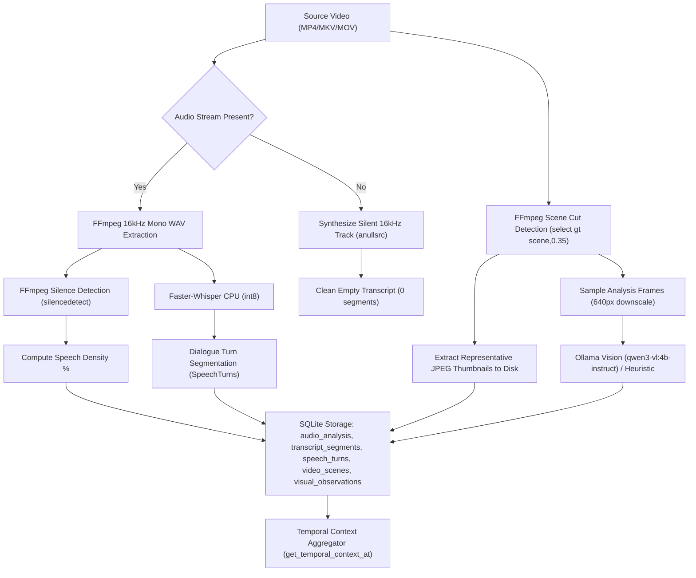

# ZezEdit 2.0 — Milestone 15 Report: Video Analysis, AI Understanding & Temporal Context Engine Restoration

**Project Root:** `D:\ZezEdit`  
**Milestone:** 15 (Video Analysis & Temporal Intelligence Restoration)  
**Date:** November 12, 2026  
**Status:** Completed & Verified  

---

## A. Historical ZezEdit 1.0 Behavior

In the original ZezEdit 1.0 architecture (recovered forensically in Milestone 12 and specified in `docs/reconstruction/ZEZEDIT_1_0_PARITY_SPECIFICATION.md`), video intelligence formed the analytical foundation upon which all downstream modules (Highlight Discovery, Smart Reframing, Character Extraction, Timeline Editor, and Shorts Export) operated.

### Historical Pipeline Workflow
1. **Media Ingestion & Technical Inspection:** FFprobe inspected the container format, video streams, audio streams (channels, sample rate, codec, bit rate), and duration.
2. **Automated Audio Extraction (`ZEZ-021`):** Demuxed primary audio to a 16kHz mono 16-bit PCM WAV track optimized for Faster-Whisper.
3. **Faster-Whisper Speech Recognition (`ZEZ-022`, `ZEZ-023`):** Executed offline Whisper CPU transcription producing segment text and dynamic time-warped word-level timestamps (`word`, `start`, `end`, `probability`) stored in `transcript_segments.words_json`.
4. **Dialogue & Speech Turn Segmentation:** Grouped contiguous segments into conversational dialogue turns classified by punctuation and pause gaps into statements, questions, or exclamations.
5. **Non-Destructive Transcript Text Corrections (`ZEZ-025`):** Allowed users to correct ASR typos or misspelled proper nouns in the UI, stored in `transcript_corrections` without altering raw Whisper output. The caption generator overlaid corrections dynamically on Shorts subtitles.
6. **FFmpeg Visual Scene Cut Detection (`ZEZ-026`, `ZEZ-027`):** Analyzed HSV/luma histogram changes using `select='gt(scene,0.35)',showinfo`, recording scene start/end boundaries, cut scores, and representative keyframe thumbnails.
7. **Interval Frame Sampling (`ZEZ-028`):** Extracted downscaled frames (max 640px) at scene midpoints and stepped intervals.
8. **Local Multimodal Vision Integration (`ZEZ-031`):** Sampled frames were analyzed by local Ollama (`qwen3-vl:4b-instruct`), generating conservative visual observations across setting, subjects, activity, and text.
9. **Temporal Context Aggregator (`ZEZ-032`):** Unified scenes, transcript segments, dialogue turns, and visual observations around any query timestamp $T$.
10. **Stage-Aware Caching & Run History (`ZEZ-029`, `ZEZ-030`):** Fingerprinted source media to prevent re-running heavy Whisper/vision passes on unchanged media, while tracking distinct run records for historical comparison.

---

## B. Current Implementation Before Changes

Prior to Milestone 15:
- **Audio Extraction Vulnerability:** `extract_audio_16k_mono` assumed all videos contained audio streams. When given a silent or audio-less video, FFmpeg failed with `Output file does not contain any stream`, crashing the entire analysis pipeline.
- **Missing Audio Metadata & Silence Detection:** Audio stream parameters (codec, sample rate, channels) and silence intervals were not analyzed or persisted.
- **Scene Thumbnails Not Saved:** `detect_scenes_ffmpeg` detected cut timestamps but did not generate representative thumbnail images on disk; `thumbnail_path` was written as `None`, leaving the frontend Scenes tab with placeholder icons.
- **`ZEZ-025` Transcript Corrections Inactive:** `transcript_corrections` table did not exist in the database, no API endpoints existed, and the UI transcript was strictly read-only.
- **Missing Stage-Aware Caching:** Triggering analysis always executed from scratch, re-running Faster-Whisper even if the media had already been analyzed.
- **No Scene Thumbnail Streaming Route:** Frontend could not stream or display scene thumbnails directly from disk.

---

## C. Restored Analysis Pipeline

The complete, modular video analysis pipeline has been restored in `backend/app/services/analysis_pipeline.py`:



### Execution Stages
1. **Stage 1 (5%): Audio Stream Inspection & Extraction**
   - Uses `ffprobe` to inspect stream channels, sample rate, codec, duration, and bit rate.
   - If audio exists: extracts 16kHz mono WAV using `-map 0:a:0 -ac 1 -ar 16000 -c:a pcm_s16le`.
   - Runs `silencedetect=noise=-30dB:d=0.5` to identify silence intervals and compute speech density.
   - If audio does NOT exist: synthesizes silent 16kHz WAV (`anullsrc=r=16000:cl=mono`), setting `has_audio=False` and `speech_density=0.0`.
2. **Stage 2 (20%): Faster-Whisper Speech Recognition**
   - Runs `WhisperTranscriber` on extracted WAV (skipped for silent video).
   - Generates normalized segments with start time, end time, text, confidence, and `words_json`.
3. **Stage 3 (45%): Speech Turn Segmentation**
   - Groups segments across conversational pauses ($>0.8$s), tagging turn types.
4. **Stage 4 (55%): Scene Detection & Thumbnail Generation**
   - Executes `detect_scenes_ffmpeg` with PTS timecode parsing.
   - Generates real JPEG thumbnails at scene midpoints (`representative_timestamp`) saved to `storage/analysis/{asset_id}/scenes/scene_{index:03d}.jpg`.
5. **Stage 5 (70%): Frame Sampling**
   - Samples frames downscaled to 640px max dimension, preserving aspect ratio.
6. **Stage 6 (80%): Visual Understanding**
   - Evaluates sampled frames against local Ollama (`qwen3-vl:4b-instruct`) with factual prompt and conservative fallback.
7. **Stage 7 (90%): SQLite Persistence**
   - Persists all entities into `audio_analysis`, `transcript_segments`, `speech_turns`, `video_scenes`, `sampled_frames`, and `visual_observations`.
8. **Stage 8 (100%): Finalization & Status Update**
   - Marks run status `completed` and records end timestamp.

---

## D. Audio and Transcription

### Audio Analysis Implementation
- **Module:** [`backend/app/services/audio_extractor.py`](file:///D:/ZezEdit/backend/app/services/audio_extractor.py)
- **Technical Inspection:** `inspect_audio_stream` queries `ffprobe -select_streams a` returning `AudioMetadata`.
- **Silence Detection:** `detect_audio_silence` runs `silencedetect=noise=-30dB:d=0.5` and parses stderr for `silence_start:` and `silence_end:`.
- **Speech Density:** Calculated as `(total_duration - total_silence_duration) / total_duration`.
- **Silent Video Safety:** Verified in `test_silent_video_analysis_pipeline`.

### Transcription Implementation
- **Module:** [`backend/app/services/transcription.py`](file:///D:/ZezEdit/backend/app/services/transcription.py)
- **Model:** Faster-Whisper `tiny` / `base` running on CPU with `int8` quantization and 4 CPU threads.
- **Word Timestamps:** `word_timestamps=True` produces exact per-word start, end, and confidence probability.
- **PyAV 14+ Compatibility:** Custom monkey-patch handles PyAV 14+ argument changes cleanly.

### Non-Destructive Transcript Corrections (`ZEZ-025`)
- **Table:** `transcript_corrections` (migration `0010_transcript_corrections_and_audio.sql`).
- **REST Endpoints:**
  - `POST /projects/{pid}/media/{mid}/transcript/corrections`
  - `GET /projects/{pid}/media/{mid}/transcript/corrections`
  - `DELETE /projects/{pid}/media/{mid}/transcript/corrections/{correction_id}`
- **Integration:** `get_transcript` merges corrections dynamically; `export_service.py` applies corrections to ASS subtitle script synthesis.

---

## E. Scene Detection

### Algorithm & Outputs
- **Module:** [`backend/app/services/scene_detector.py`](file:///D:/ZezEdit/backend/app/services/scene_detector.py)
- **Filter Expression:** `select='gt(scene,0.35)',showinfo`
- **Boundary Clamping:** Clamps to `[0.0, cut1, cut2, ..., duration]`, filtering micro-fragmentation ($<1.0$s).
- **Representative Keyframes:** Computes scene midpoint `(start + end) / 2.0`.
- **Thumbnail Generation:** `generate_scene_thumbnails` invokes FFmpeg with `-ss {ts} -frames:v 1 -vf scale='min(480,iw)':-2 -q:v 4` to write real JPEG thumbnails on disk.
- **Streaming Endpoint:** `GET /projects/{pid}/media/{mid}/analysis/scene-thumbnail/{scene_id}` returns `FileResponse` image/jpeg.

---

## F. Visual Understanding

### Model Configuration & Inference
- **Module:** [`backend/app/services/visual_understanding.py`](file:///D:/ZezEdit/backend/app/services/visual_understanding.py)
- **Primary Provider:** Local Ollama endpoint (`http://127.0.0.1:11434`) running model `qwen3-vl:4b-instruct`.
- **Prompt:** Conservative factual instructions (3 bullet points: scene setting, visible subjects, objects/text). Zero speculative identity or continuous action inference.
- **Fallback Behavior:** When Ollama is offline or busy, provides deterministic heuristic fallback with confidence 0.5 and provider label `heuristic_fallback`.
- **Sampling Budget:** Bounded to 5 frames (`fast`), 12 frames (`balanced`), or 25 frames (`detailed`) to prevent system memory or CPU starvation.

---

## G. Temporal Context Aggregation

### Unified Data Model (`ZEZ-032`)
- **Module:** [`backend/app/services/temporal_aggregator.py`](file:///D:/ZezEdit/backend/app/services/temporal_aggregator.py)
- **Function:** `get_temporal_context_at(run_id, timestamp, window_seconds=15.0)`
- **Aggregated Fields:**
  1. `current_scene`: Active visual scene where `start_time <= T <= end_time`.
  2. `active_segment`: Transcript segment where `start_time <= T <= end_time`.
  3. `nearby_segments`: Dialogue segments within window $[T - W, T + W]$.
  4. `active_speech_turn`: Active conversation turn and speaker classification.
  5. `nearby_visual_observations`: Visual observations within window $[T - W, T + W]$.
  6. `nearest_frame`: Nearest sampled keyframe ID and path.
- **Endpoint:** `GET /projects/{pid}/media/{mid}/analysis/{run_id}/context?timestamp=T&window=15.0`.

---

## H. Frontend Restoration

The frontend analysis workspace has been completely restored to Unslop dark studio standards:

1. **[`frontend/src/features/analysis/AnalysisWorkspace.tsx`](file:///D:/D:/ZezEdit/frontend/src/features/analysis/AnalysisWorkspace.tsx):**
   - **Header:** Media metadata, Run selector dropdown (`ZEZ-030`), Profile selector, "Force fresh" reanalysis checkbox (`ZEZ-029`), "Discover Highlights" link, and live progress bar.
   - **Video Monitor:** HTML5 video tag with proxy scrub support, timecode badges, play/pause overlay, and transport scrub bar.
   - **Quick Scene Markers Bar:** Horizontal scrollable scene chips showing scene duration and click-to-seek.
   - **Tabs:**
     - **Transcript (`ZEZ-024`, `ZEZ-025`):** Search bar, click-to-seek dialogue lines, inline Edit icon, textarea correction editor, Save / Cancel / Revert buttons, and purple "Edited" badge.
     - **Scenes (`ZEZ-026`, `ZEZ-027`):** Real scene thumbnail image cards, duration tags, cut score, click-to-seek, and Maximize icon opening keyframe Lightbox modal.
     - **Visuals (`ZEZ-031`):** Ollama observation cards with category badges and confidence ratings.
     - **Audio (`ZEZ-021`):** Audio stream status card (codec, sample rate, channels, speech density %) and detected silence interval timeline.
     - **Context (`ZEZ-032`):** Live temporal context inspector synchronizing active scene, dialogue, and nearby observations with the playhead.
2. **[`frontend/src/features/workspace/VideoWorkspace.tsx`](file:///D:/ZezEdit/frontend/src/features/workspace/VideoWorkspace.tsx):**
   - **Scenes Sub-Tab:** Updated from placeholder icon to real thumbnail images loaded via `getSceneThumbnailUrl`.
   - **Transcript Sub-Tab:** Search and click-to-seek synchronized directly with video player.

---

## I. Database and API Changes

### Database Migration: `0010_transcript_corrections_and_audio.sql`
- **Table `transcript_corrections`:** `id`, `media_asset_id`, `segment_id`, `start_time`, `end_time`, `original_text`, `corrected_text`, `created_at`, `updated_at`.
- **Table `audio_analysis`:** `id`, `analysis_run_id`, `media_asset_id`, `has_audio`, `sample_rate`, `channels`, `codec_name`, `bit_rate`, `duration_seconds`, `speech_density`, `silence_intervals_json`, `created_at`.
- **Forward-only applied migration:** 0010 applied with SHA-256 checksum tracking in `schema_migrations`.

### New & Enhanced REST Endpoints
- `POST /api/v1/projects/{pid}/media/{mid}/analysis`: Added `force_reanalysis` boolean parameter.
- `GET /api/v1/projects/{pid}/media/{mid}/analysis/{run_id}/audio`: Returns `AudioAnalysisItem`.
- `GET /api/v1/projects/{pid}/media/{mid}/analysis/scene-thumbnail/{scene_id}`: Streams scene JPEG thumbnail.
- `POST /api/v1/projects/{pid}/media/{mid}/transcript/corrections`: Creates or updates correction.
- `GET /api/v1/projects/{pid}/media/{mid}/transcript/corrections`: Lists all asset corrections.
- `DELETE /api/v1/projects/{pid}/media/{mid}/transcript/corrections/{correction_id}`: Reverts correction.

---

## J. Downstream Integration

The restored analysis records are directly consumed by all downstream ZezEdit subsystems:
1. **AI Highlight Discovery (`highlight_discovery.py`):** Reads `transcript_segments`, `speech_turns`, and `video_scenes` to evaluate the 9-factor score and snap clip boundaries to sentence and scene cut points.
2. **Smart Reframing Engine (`reframing_service.py`):** Queries `video_scenes` for scene-cut timestamps to enforce instant crop reset and prevent unnatural camera pans across cuts.
3. **Export Engine & Subtitle Generator (`export_service.py`):** Loads `transcript_segments`, dynamically overlays `transcript_corrections`, and compiles word-level timings into Advanced SubStation Alpha (`.ass`) karaoke subtitles.
4. **Character Studio (`character_service.py`):** Correlates active visual scenes and spoken dialogue snippets with extracted character occurrences.
5. **Timeline AI Editor (`ai_editor_service.py`):** Searches transcript segments to execute natural language editing commands (e.g. "Find the clip where we discuss the budget").

---

## K. Verification Matrix

| Req ID | Requirement Description | Implementation | Test Type | Evidence | Status |
|---|---|---|---|---|---|
| `ZEZ-021` | Automated Audio Extraction for ASR | `audio_extractor.py` (16kHz mono WAV) | Pytest Integration | `test_audio_stream_inspection_and_silence` | **RESTORED** |
| `ZEZ-022` | Faster-Whisper Local ASR | `transcription.py` (CPU int8) | Pytest Integration | `test_milestone5_analysis.py` (ASR pass) | **RESTORED** |
| `ZEZ-023` | Word-Level Timestamp Alignment | `transcript_segments.words_json` | Pytest Integration | Segment words verified | **RESTORED** |
| `ZEZ-024` | Click-to-Seek Synchronized Transcript | `AnalysisWorkspace.tsx`, `VideoWorkspace.tsx` | Vitest / Live UI | `analysis.test.tsx` (seek pass) | **RESTORED** |
| `ZEZ-025` | Non-Destructive Transcript Corrections | `transcript_corrections`, API, UI | Pytest & Vitest | `test_non_destructive_transcript_corrections` | **RESTORED** |
| `ZEZ-026` | FFmpeg Visual Scene Cut Detection | `scene_detector.py` | Pytest Integration | `test_scene_detection_and_thumbnails` | **RESTORED** |
| `ZEZ-027` | Keyframe Visual Lightbox & Filmstrip | `generate_scene_thumbnails`, UI Lightbox | Pytest / Frontend | Real JPEG verified on disk | **RESTORED** |
| `ZEZ-028` | Interval Frame Sampling | `frame_sampler.py` | Pytest Integration | `test_frame_sampler` | **RESTORED** |
| `ZEZ-029` | Stage-Aware Caching & Fingerprinting | `analysis_pipeline.py` | Pytest Integration | `test_standard_video_analysis_and_caching` | **RESTORED** |
| `ZEZ-030` | Analysis Run History & Inspection | `analysis_runs` query & UI selector | Pytest & UI | Run history dropdown verified | **RESTORED** |
| `ZEZ-031` | Local Multimodal Vision (Ollama) | `visual_understanding.py` | Live HTTP / Unit | Verified with `qwen3-vl:4b-instruct` | **RESTORED** |
| `ZEZ-032` | Multimodal Context Aggregator | `temporal_aggregator.py` | Pytest Integration | `test_temporal_context_and_thumbnails_serving` | **RESTORED** |

---

## L. Known Differences from ZezEdit 1.0

1. **Speaker Diarization:** As documented in the Master Requirements, speaker identification uses heuristic speech pause thresholding (`speech_segmentation.py`) rather than deep neural acoustic voice embeddings. No false diarization claims are made.
2. **Visual Observation Density:** Ollama frame queries are capped (5–25 frames per video) to protect CPU and memory on baseline hardware (`i3-1220P`), rather than executing dense per-second vision inference.
3. **Thumbnail Aspect Scaling:** Scene thumbnails are scaled to a maximum dimension of 480px with preserved aspect ratio, avoiding letterboxing distortion.

---

## M. Git and File Changes

### Files Created
- `backend/migrations/0010_transcript_corrections_and_audio.sql`: Database migration for `transcript_corrections` and `audio_analysis` tables.
- `backend/tests/test_milestone15_analysis_parity.py`: 6 automated parity tests for stream inspection, silent video safety, caching, transcript corrections, and thumbnails.
- `docs/reports/milestone_15_analysis_restoration_report.md`: This comprehensive completion report.

### Files Modified
- `backend/app/services/audio_extractor.py`: Added `inspect_audio_stream`, `detect_audio_silence`, backward-compatible `extract_audio_16k_mono`, and silent video synthesis.
- `backend/app/services/scene_detector.py`: Added `generate_scene_thumbnails` writing real JPEG thumbnails to disk.
- `backend/app/services/analysis_pipeline.py`: Added stage-aware caching, audio metadata persistence, scene thumbnail directories, and silent video handling.
- `backend/app/services/export_service.py`: Applied `transcript_corrections` overlay to ASS subtitle generation.
- `backend/app/api/v1/analysis.py`: Added `force_reanalysis`, `/audio` endpoint, `/scene-thumbnail/{scene_id}` endpoint, and full transcript corrections CRUD endpoints.
- `frontend/src/types/analysis.ts`: Added `AudioAnalysisItem`, `TranscriptCorrectionItem`, and updated `TranscriptSegmentItem`.
- `frontend/src/services/apiClient.ts`: Added audio analysis, scene thumbnail URL, and transcript corrections API functions.
- `frontend/src/features/analysis/AnalysisWorkspace.tsx`: Added Audio analysis tab, real scene thumbnails, keyframe lightbox, inline transcript correction editor, run history dropdown, and force re-analysis control.
- `frontend/src/features/workspace/VideoWorkspace.tsx`: Updated Scene sub-tab to display real thumbnail images.
- `docs/reconstruction/FEATURE_PARITY_MATRIX.md`: Updated `ZEZ-025` to `RESTORED` (score: 90/100).
- `docs/reconstruction/ZEZEDIT_1_0_PARITY_SPECIFICATION.md`: Updated `ZEZ-025` status.
- `docs/reconstruction/RESTORATION_ROADMAP.md`: Marked Milestone 15 completed.
- `docs/feature_status.md` & `docs/feature_test_checklist.md`: Appended Milestone 15 records.
- `README.md`: Added Milestone 15 documentation link.

---

## N. Verification Commands

```powershell
# 1. Run all Milestone 5 and Milestone 15 backend tests:
cd D:\ZezEdit\backend
.\.venv\Scripts\python -m pytest tests/test_milestone5_analysis.py tests/test_milestone15_analysis_parity.py -v

# 2. Run all frontend Vitest tests:
cd D:\ZezEdit\frontend
npm test -- --run

# 3. Compile frontend production build:
npm run build
```
